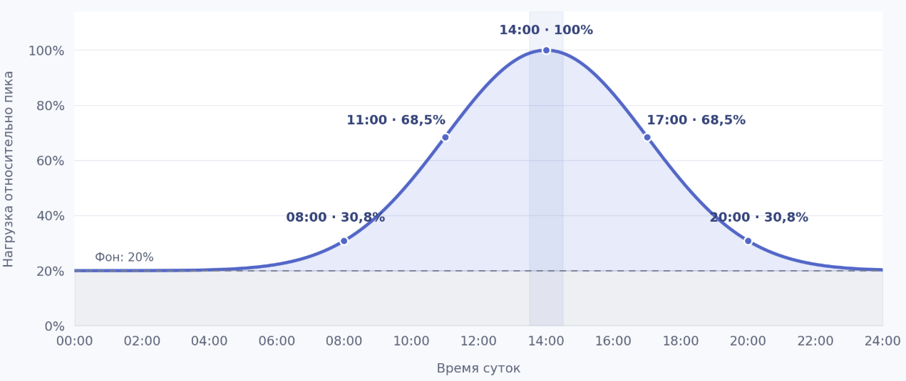
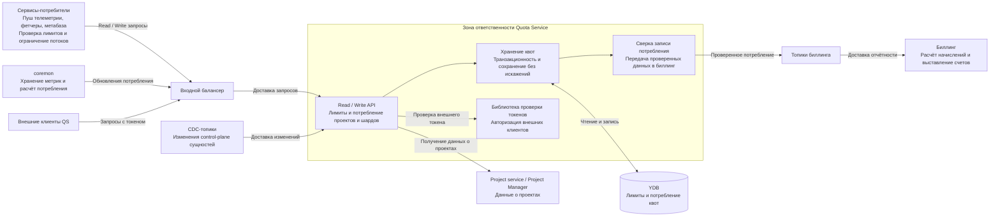

# ПР2

> **Важно: это учебный проект.** В материалах используются общедоступные сведения о Яндексе (Yandex), Yandex Cloud и Monium со ссылками на публичные источники. Оговорка о вымышленности не распространяется на сведения, прямо подтверждённые этими источниками. Все остальные конкретные данные — цены и тарифы, правила, требования, ограничения, показатели, состав команд, архитектура, процессы, SLA/SLO, сроки и компенсации — являются вымышленными условиями учебного сценария. Авторские расчёты, оценки, таблицы и иллюстрации на основе публичных данных также являются учебными и не подтверждают реальные показатели или обязательства компании и сервиса. Материалы не являются официальной документацией или заявлениями Яндекса, Yandex Cloud и Monium. Формулировки «мы», «наш сервис» и подобные относятся к участникам учебного сценария.

## Паспорт

### Компания и продукт

Yandex

Observability платформа Monium

https://monium.yandex.cloud

### Тип цифрового бизнеса

Тип: SaaS

Модель монетизации: Pay-per-use

### Выбранный ИТ-сервис

Сервис квотирования - это наш сервис который отвечает за управления всеми доступными пользователю квотами. Этот сервис хранит эти квоты и предоставляет API другим сервисам, для их изменения + получения текущих лимитов и юзаджа. 

На данный момент квота сервис отвечает за квотирование исключительно метрик.

### Годовой оборот и способ подтверждения

Мы тарифицируем пользователей: 
- по использованию метрик (объем хранения шт, величина потока на запись шт\с)
- по записи логов \ трейсов в секунду (объем ГБ)
- по числу вычисляемых алертов и сработавших эскалаций

Для учебного расчёта используются [публичные тарифы Monium](https://yandex.cloud/ru/docs/monium/pricing) и опубликованные показатели нагрузки (см. раздел «Пользователи и нагрузка»). Сам расчёт и его допущения являются авторской учебной моделью.

Для условной оценки выручки опубликованные значения приняты за пиковые. Это допущение учебного расчёта; предполагаемый профиль нагрузки представлен на иллюстрации:

Расчёт по публичным тарифам с принятым учебным профилем нагрузки даёт условную выручку около 15 млрд в год. Это результат авторской модели, а не опубликованная финансовая статистика или подтверждённая реальная выручка Monium.

### Пользователи и нагрузка

По сути сервисом опосредовано пользуются все, как и внешние клиенты, которые записывают в нас телеметрию, так и соседнии с нами сервисы, для того чтобы ограничивать те или иные потоки данных исходящие от клиентов на основе выставленных для них лимитов.

MAU 16.000 пользователей

3.000.000.000 семплов метрик в секунду

44.000.000 миллионов спанов в секунду

60ГБ/c обрабатываем логов

Источник показателей пользователей и нагрузки: [публичная страница команды Monium](https://yandex.ru/jobs/services/cloud/monium). Использование этих показателей как пиковых в расчёте выручки — отдельное учебное допущение.

### Режим данных

Наши данные - это телеметрия, мы занимаемся ее сбором (свои агенты, фетчеры), приемкой (инжест), обработкой (временные рядя, логи, трейсы) и выстраиванием платформы поверх этих данных (считаем алерты, SLO, рисуем дашики, графики, итд итп). Это если говорить про весь продукт в целом.

Конкретно в QS данные телеметрии мы не храним и не обрабатываем, тут данные - это деревья квот, где по каждому проекту, шарду мы храним узлы с потреблением и лимитами квот.

## Сервис: зона ответственности и окружение

QS предоставляет Read/Write API для квот метрик проектов и шардов, обеспечивает долговременное хранение, транзакционность изменений и сохранение принятого потребления без искажений. Проверку лимитов и ограничение потоков выполняют сервисы-потребители; они же отвечают за расчёт переданного потребления. Хранение телеметрии и выставление счетов находятся вне зоны ответственности QS.

### Диаграмма зависимостей сервиса

Стрелки показывают направление запросов или передачи данных; ответы API возвращаются по тому же пути. Внутри рамки выделены функции QS, снаружи — потребители и зависимости учебного сценария.

Основные внешние зависимости QS — YDB, входной балансер, CDC-топики и Project service. Их отказ, повлиявший на QS, учитывается в SLA. Топики биллинга — канал передачи потребления. При расхождениях QS приостанавливает передачу затронутых данных в биллинг и сохраняет их для повторной отправки после исправления и проверки.

## Регламент

### Incident management 

#### Матрица приоритетов по инцидентам

| Влияние ↓ / Срочность → | Высокая: работа остановлена, обхода нет | Средняя: работа ограничена, есть временный обход | Низкая: можно отложить без роста потерь |
| --- | --- | --- | --- |
| Высокое: затронуто ≥ 20% активных проектов зоны | P1 | P2 | P3 |
| Среднее: затронуто ≥ 1% и < 20% активных проектов зоны | P1 | P3 | P4 |
| Низкое: затронуто < 1% активных проектов зоны | P3 | P4 | P4 |

##### Критерии присвоения приоритетов

Приоритет определяется отдельно по каждой зоне доступности за скользящее окно **5 минут**. Если затронуты несколько зон, назначается наиболее высокий из полученных приоритетов. Подтверждённое искажение или отставание записи потребления более 1 часа требует немедленного назначения P1 без ожидания завершения окна.

**1. Показатели нарушения работы**

| Показатель | Критерий | Основание |
| --- | --- | --- |
| Неуспешный Read-запрос | Ответ 5xx, невозможность соединения или превышение таймаута 500ms | SLA: доступность Read API ≥ 99.9% за месяц, бюджет неуспешных запросов ≤ 0.1% |
| Неуспешный Write-запрос | Ответ 5xx, невозможность соединения или превышение таймаута 5s | SLA: доступность Write API ≥ 99% за месяц, бюджет неуспешных запросов ≤ 1% |
| Деградация доступности API | Доля неуспешных Read-запросов > 0.1% или Write-запросов > 1% за 5 минут | Операционный критерий регламента на основе месячных целей SLA |
| Деградация задержек | Read: p95 > 200ms или p99 > 500ms; Write: p95 > 1s или p99 > 5s за 5 минут | Операционный критерий регламента на основе месячных целей SLA по успешным запросам |
| Массовая недоступность Read API | ≥ 20% неуспешных Read-запросов за 5 минут | Дополнительный порог массовости регламента; всегда P1 |
| Отставание записи потребления | Хотя бы 1 принятое обновление не записано в YDB более 1 часа после отправки | Основание P1 из SLA; SLO своевременности — ≥ 99.9% обновлений в течение 1 часа за месяц |
| Искажение потребления со стороны QS | Хотя бы в 1 операции принятое значение не совпало с параметром записи или фактически сохранённым значением по вине QS | Основание P1 из SLA; SLO надёжности — ≥ 99.9% записей без искажений за месяц, бюджет ошибок — 0.1% |

Доля ошибок рассчитывается как `число неуспешных запросов / общее число запросов × 100%`, отдельно для Read и Write API. Запросы, не дошедшие до QS, учитываются по данным балансера и потребителей с исключением повторного учёта одного запроса. При отсутствии запросов доля не рассчитывается. Для задержек учитываются только успешные запросы.

Пороги алертов из SLA: доля обновлений с отставанием более 1 часа **≥ 1.5% за 5 минут**, доля записей с расхождениями **> 1.5% за 5 минут**. Для первого показателя учитываются обновления, чей часовой срок истёк в окне. Эти пороги запускают оповещение, но не отменяют P1 при подтверждённом единичном нарушении.

**2. Масштаб влияния — строки матрицы**

Затронутым считается проект, в котором за окно зафиксирован хотя бы 1 сбой операции по вине QS, превышен порог деградации задержек либо подтверждено влияние дефекта сервиса или его документации на используемый сценарий. Масштаб определяется по доле затронутых активных проектов:

`U = число затронутых активных проектов / число всех активных проектов зоны × 100%`. Активные проекты — проекты, обращавшиеся к QS за последние 24 часа, включая текущее окно.

| Масштаб влияния | Численный порог |
| --- | --- |
| Высокое | U ≥ 20% |
| Среднее | 1% ≤ U < 20% |
| Низкое | U < 1% |

**3. Срочность — столбцы матрицы**

| Срочность | Измеримый критерий |
| --- | --- |
| Высокая | Хотя бы в 1 затронутом проекте все попытки обязательной для текущей работы операции завершаются неуспешно в течение 5 минут, и нет проверенного обхода, позволяющего завершить эту операцию. Запись метрик или необходимое изменение квоты остановлены. |
| Средняя | Высокая срочность не подтверждена; за 5 минут есть хотя бы 1 неуспешная необходимая операция или превышен порог деградации API, но повторные запросы либо проверенный обход позволяют завершать необходимые операции. Обновления потребления сохраняются не позднее 1 часа, искажений по вине QS нет. |
| Низкая | Высокая и средняя срочность не подтверждены; число остановленных и неуспешных необходимых операций — 0, пороги деградации API не превышены, число искажений и обновлений с отставанием более 1 часа — 0. Исправление можно отложить на 24 часа без блокировки записи метрик и без потери или искажения учёта потребления; это подтверждено данными мониторинга и затронутым потребителем. |

Для выбора срочности условия проверяются сверху вниз. Непроверенный обход не считается доступным. Для нагрузки ориентиром служит ёмкость из SLA: **400 000 RPS чтения**, **5 000 RPS записи**, пик чтения **600 000 RPS не дольше 1 часа**. Превышение нагрузки не снижает приоритет при уже подтверждённом влиянии.

#### Порядок реакции и оповещения:

Дежурный по сервису реагирует на поступившее обращение уровня P1 или P2 в течении 10 минут. После оценки угрозы, если она подтверждается, дежурный заводит инцидент, который сразу вывешивается на публичной доске доступности сервиса. 

#### Переходы по статусам

1. При заведени, инцидент получает статус "Расследование" и ETA на выяснение причин - 15 минут для P1 и P2; Для P3 и ниже инцидент не заводится;

2. После обнаружение причины главная цель - снять импакт. Инцидент переводится в статус "Работы по восстановлению". На этап восстановления, включая проверку результата, отводится 45 минут для P1 и 105 минут для P2. Вместе с реакцией 10 минут и расследованием 15 минут общий срок по SLA — 70 минут для P1 и 130 минут для P2;

3. После снятие импакта и восстановление работы сервиса инцидент переводится в статус. "Сервис восстановлен". Дежурный должен заполнить данные по инциденту:
    - Затронутые зоны доступности
    - Страдали ли пользователи
    - Страдали ли внешние пользователи
    - Таймлайн
    - Затронутые сервисы-потребители
    - Причины инцидента
ETA на заполнение инцидента 2 дня; 

4. После заполнения инцидента внутри SRE команды проводится обсуждение и большинством голосов решается необходим ли дополнительный разбор инциденту на LSR. Для P1 разбор обязателен. В случае необходимости дополнительного разбора он переводится в статус "Ждет разбора", ETA на разбор 5 дней; Команда фиксирует выявленные проблемы в связанных с инцидентом задачах. Action Items составляют план решения каждой проблемы: действие, исполнитель, срок и проверяемый результат. Сроки согласуются с командой-владельцем, за выполнение отвечает лид команды; Problem manager контролирует прогресс и проверку результата.

5. Инцидент переводится в статус "Закрыт" после восстановления сервиса и оформления AI либо после восстановления, если SRE команда решила, что дополнительный разбор не нужен. Связанные задачи проблем остаются открытыми до выполнения и проверки их AI.

### Service request management

#### Приём и учёт обращений

L1 фиксирует в тикете заявителя, тип запроса и параметры, проверяет права и полноту данных. Недостающие сведения запрашивает у пользователя; полный запрос выполняет по инструкции либо передаёт L2. Запросы, доступные через форму, обрабатывает скрипт; отказы и исключения разбирает поддержка.

L1/L2 записывают фактическое время работы по каждому обращению. Однотипные обращения группируются; лид поддержки собирает число обращений в неделю, время на одно обращение и суммарные затраты. Данные и выполняемые действия передаются на разбор по Change enablement.

#### Каталог запросов

| Тип запроса | Результат и границы запроса | Срок выполнения | Согласование | Что автоматизировано и кто выполняет |
| --- | --- | --- | --- | --- |
| Получение текущих лимитов и потребления | Снимок квот указанных проектов и шардов с временем получения; только проекты, доступные заявителю | 1 час | Дополнительное согласование не требуется при наличии права чтения | Получение значений автоматически через Read API; Service desk agent проверяет область запроса и передаёт результат |
| Выгрузка логов для сверки с биллингом | Логи операций записи потребления по проектам, шардам и traceId; период выгрузки не более 30 дней | 3 часа | Для собственных проектов достаточно подтверждённого права просмотра; для передачи логов другой команде требуется согласие Customer команды-владельца проектов | Сбор логов выполняется штатным инструментом; дежурный проверяет состав данных и вручную передаёт выгрузку |
| Перенос квоты между проектами | Перераспределение лимита без увеличения общей квоты; остаток квоты источника не ниже его текущего потребления | 8 часов | Customer каждого проекта подтверждает перенос; Change authority разрешает применение | Write API выполняет перенос; Technical specialist проверяет полномочия, исходные лимиты, потребление и итоговые значения. Межпроектное согласование выполняется вручную |
| Перенос квоты между шардами одного проекта | Лимит источника после переноса не ниже потребления; сумма лимитов и проектная квота не меняются | Результат возвращается при обработке формы; исключения — по срокам поддержки P3/P4 | Право управления квотами проекта; инструкция предодобрена Change authority, отдельное разрешение на каждый перенос не требуется | Customer заполняет форму; скрипт проверяет права, лимиты и юзадж, применяет перенос одной операцией с проверкой версии, проверяет результат и сохраняет его в заявке. При изменении версии повторяет чтение и проверку; отказ возвращает с причиной |
| Сверка потребления без изменения данных | Отчёт о расхождениях между данными сервиса-потребителя и QS; 1 проект, 1 зона доступности, период до 24 часов. Записи QS и отправка в биллинг не изменяются | 24 часа | Customer подтверждает область сверки; команда сервиса-потребителя предоставляет исходные данные. Изменение данных не согласуется в рамках этого запроса | Подготовленная утилита выполняет расчёт в dry-run; Technical specialist запускает её и проверяет отчёт. Интерпретация расхождений выполняется вручную |

### Change enablement

Перед изменением QS оцениваем риск, согласуем применение и время работ. Это касается кода, конфигурации, схемы хранения, мониторинга и исправления данных.

Запросы поступают из квартальных проектов, FF, задач SRE, инцидентов и обращений L3. Change coordinator направляет запрос в команду. Тип определяется условиями изменения.

#### Типы изменений

| Тип | Когда применяется | Кто разрешает | Примеры |
| --- | --- | --- | --- |
| **Стандартное** | Низкий риск; есть предодобренная, проверенная инструкция; все её условия выполнены | Change authority утверждает инструкцию заранее. Повторное разрешение не требуется; согласие владельцев проектов остаётся обязательным | Перенос квоты по утверждённой инструкции без увеличения общей квоты и снижения остатка ниже потребления |
| **Обычное** | Нет подходящей предодобренной инструкции и оснований для экстренного порядка | Назначенный согласующий команды; для обычных изменений после L3 — лид команды | Изменение схемы YDB, новая логика сверки потребления, новые правила алертинга |
| **Экстренное** | Ожидание обычного согласования увеличивает ущерб от сбоя, искажения данных или непосредственной угрозы безопасности | Дежурный по сервису; при выходе за его полномочия — Service owner | Обновление библиотеки при эксплуатации уязвимости; исправление продолжающегося искажения потребления |

#### Запрос и согласование

В запросе фиксируем:

- цель и критерии результата, ссылку на исходную задачу;
- тип изменения, затронутые компоненты, проекты и зоны;
- риск и влияние на компоненты сервиса и пользователей;
- исполнителя, согласующего, время и длительность работ;
- результаты тестов, шаги выполнения, проверки, условия остановки и план восстановления.

Для стандартного изменения достаточно ссылки на версию инструкции и параметров операции. Изменение инструкции требует новой оценки риска и предодобрения.

Change coordinator проверяет запрос и пересечения работ, Change authority разрешает применение, Deployment manager организует выкатку и проверки по этапам. Дополнительные ресурсы и решения за пределами полномочий согласует Service owner. Работы записываются в расписание с исполнителем и затронутыми зонами.

Перед работами проверяем запас мощности по SLA и возможность восстановить сервис без потери принятых данных.

#### Разбор обращений для автоматизации

Раз в 2 недели лид поддержки предоставляет лиду сервиса статистику однотипных обращений и последовательность действий инженеров. На встрече формируются заявки на изменения: цель, какие действия и как автоматизировать, что останется поддержке, критерии результата.

Заявки ранжируются по суммарным затратам времени в неделю; при равных затратах выше ставится более частое обращение. Service owner включает их в план команды, Change coordinator направляет на согласование. После внедрения сравниваем число ручных обращений и затраты с исходными данными.

Для релизов Change coordinator фиксирует минорный или мажорный порядок по критериям Deployment management. Минорные согласуются в задаче, мажорные — на еженедельном совещании с Change authority; решение записывается в задаче. Стандартные и экстренные изменения сохраняют свой порядок разрешения.

#### Уведомления и порядок экстренных работ

Сроки уведомления по SLA: **S — минимум за сутки, M — за 3 дня, L — за неделю**. S/M/L определяют размер влияния работ, а не тип изменения. Деградация во время работ учитывается в доступности.

Для экстренного изменения до выполнения фиксируем причину, влияние, разрешение, исполнителя и план восстановления. Проводим доступные проверки, записываем пропущенные проверки и принятые риски. Если ждать нельзя, уведомляем потребителей сразу после решения; нарушение срока уведомления учитывается по SLA. Полное описание дополняем после стабилизации, не позднее **2 дней**.

### Problem management

Проблема — причина или потенциальная причина сбоя QS: ошибок Read/Write API, потери или искажения потребления, отставания записи в YDB либо передачи неверных данных в биллинг. Она выявляется на разборе инцидента, при расследовании обращения поддержки или по данным мониторинга.

Лид команды согласует сроки и отвечает за выполнение. Problem manager контролирует AI и проверяет результат; просрочки и нехватку ресурсов передаёт Service owner. Изменения выполняются через Change enablement. Инцидент можно закрыть после восстановления и оформления проблем с AI; задачи проблем остаются открытыми до проверки решения.

#### Разбор инцидентов и Action Items

На LSR команда определяет, где произошёл сбой: балансер, обработка запроса QS, запись в YDB, получение данных проекта или репорт в биллинг. Отдельно фиксирует, почему мониторинг не обнаружил нарушение и что задержало восстановление. Для P1 разбор обязателен; для P2 решение принимает SRE команда.

На каждую проблему заводится задача, связанная с инцидентом. **Action Items — план решения этой проблемы в той же задаче:** что сделать, кто отвечает, к какому сроку и как проверить результат. Отдельный список улучшений без связи с проблемами не ведётся.

#### Передача из поддержки

- **L1:** проверяет документацию QS и известные ошибки, применяет готовый обход. Если решения нет, передаёт на L2 projectId, shardId, traceId, время и зону, операцию Read/Write API, код ответа или таймаут, ожидаемые и полученные лимиты/потребление, выполненные действия.
- **L2:** по traceId сопоставляет запрос на балансере и в QS, проверяет ошибки и задержки доступа к YDB. Для записи сравнивает принятое потребление, параметр записи и сохранённое значение по идентификатору операции или версии; Если штатное решение восстановило работу и дефект не остался, закрывает обращение с результатом проверки. Если причина не установлена или нужен анализ кода, передаёт на L3 данные L1, ссылки на логи/графики, проверенные гипотезы, шаги воспроизведения и результат проверки обхода; для записи потребления — идентификатор операции, три сверяемых значения и время записи. Отсутствующие данные явно отмечает.
- **L2 → Problem manager:** при выявленном дефекте или повторении одинаковых симптомов связывает обращение с существующей проблемой либо передаёт тот же пакет для её регистрации. В обращении фиксируются задача проблемы и назначенный исполнитель L3; до подтверждения приёма ответственность за передачу остаётся у L2.
- **L3:** локализует дефект обработки запроса, записи в YDB или репорта, готовит исправление и проверку исходной операции. Если QS сохранил ровно переданное потребление, а исходное значение неверно, передаёт команде отправителя (coremon) traceId, значения и результат dry-run сверки с её данными; фиксирует владельца исправления и связанную задачу. QS предоставляет доказательства, а потребление по телеметрии пересчитывает отправитель.

При признаках P1/P2 любая линия сразу привлекает Incident manager. Обращение закрывается после восстановления чтения квот, изменения лимита или записи потребления у затронутого проекта, в том числе обходом, с указанием связанной проблемы. Обещание исправить дефект без восстановления работы не является основанием для закрытия.

#### Примеры назначения AI к выявленным проблемам

| Выявленная проблема QS | AI и проверка результата |
| --- | --- |
| Принятое потребление искажено при записи в YDB | Исправить путь записи; воспроизвести сбой и подтвердить равенство принятого значения, параметра записи и сохранённого значения для одной операции |
| Write API отвечает успешно, но искажения не обнаруживаются до биллинга | Добавить сверку значений, логи с traceId и алерт; при тестовом расхождении подтвердить обнаружение и блокировку передачи затронутых данных в биллинг |
| Обновления потребления отстают более чем на 1 час | Устранить подтверждённое ограничение записи; проверить под нагрузкой из SLA, что ≥ 99.9% обновлений записаны в течение часа за согласованное окно проверки |

### Monitoring and event management

QS мониторится в Monium из своей и соседней инсталляции. Метрики рассчитываются отдельно по зоне, Read/Write API и шарду; числитель и знаменатель суммируются до расчёта доли. Среднее процентов по шардам не используется. Алерты проверяются каждую минуту по скользящему окну 5 минут, если ниже не указан другой период.

#### Что измеряем и когда оповещаем

Для каждого правила уровень выбирается автоматически: сначала проверяется условие **disaster**, затем **alarm**. Если оба выполнены, отправляется только disaster. Получатель обоих уровней — текущий дежурный QS.

| Показатель | Как измеряем | alarm — сообщение в чат | disaster — сообщение и звонок |
| --- | --- | --- | --- |
| Доступность Read/Write API | `неуспешные / все запросы × 100%` по балансеру, QS и потребителям. Неуспех — 5xx, невозможность соединения, таймаут Read > 500ms / Write > 5s | Read > 0.1% или Write > 1% за 5 минут | Read ≥ 1.5% одновременно за 5 минут и 1 час; Write ≥ 15% одновременно за 5 минут и 1 час. Отдельно: Read ≥ 20% за 5 минут, без ожидания часового порога |
| Задержки API | p95/p99 успешных запросов по объединённым гистограммам реплик | Read: p95 > 200ms или p99 > 500ms; Write: p95 > 1s или p99 > 5s за 5 минут | Read p95 > 400ms одновременно за 5 минут и 1 час либо Write p95 > 2s одновременно за 5 минут и 1 час |
| Отставание записи потребления | Сопоставляем отправку и запись в YDB по идентификатору обновления. Возраст незаписанного обновления — текущее время минус время отправки | Есть хотя бы 1 незаписанное обновление возрастом > 30 минут и ≤ 1 часа | Есть хотя бы 1 незаписанное обновление возрастом > 1 часа. Дополнительно: доля опозданий ≥ 1.5% за 5 минут среди обновлений, чей часовой срок истёк в окне |
| Искажение потребления | Автоматическая сверка принятого значения, параметра записи и значения в YDB для одной операции/версии | Не применяется: расхождение требует немедленного оповещения | Число новых операций с расхождением ≥ 1. Дополнительно: доля операций с расхождением > 1.5% за 5 минут среди проверенных операций |
| Запас пропускной способности | Средний RPS за 5 минут отдельно для Read/Write; длительность превышения 400 000 RPS чтения | Read ≥ 320 000 RPS или Write ≥ 4 000 RPS. В сообщении отдельно отмечается Read > 600 000 RPS, Write > 5 000 RPS либо Read > 400 000 RPS непрерывно более 1 часа | Не применяется: RPS сам по себе не вызывает звонок. Ошибки и задержки оцениваются отдельными правилами выше |

Запрос учитывается один раз; повторные попытки API — отдельные запросы, повторы одного обновления потребления — одна операция. Сравнение разных версий исключается из проверки искажений. При нулевом знаменателе доли и перцентили не рассчитываются; отсутствие данных не считается успешной работой.

Логи содержат время, зону, projectId, shardId, traceId, идентификатор операции/версию и три сверяемых значения. Отсутствующий результат сверки учитывается в контроле мониторинга, а не как запись без искажения.

Таймауты, цели задержек, часовой срок записи и пороги 1.5% взяты из SLA. Для доступности disaster означает расход бюджета в 15 раз быстрее допустимого: 1.5% при бюджете Read 0.1%, 15% при бюджете Write 1%. Два окна, удвоенный p95, предупреждение об отставании после 30 минут и остальные оперативные пороги установлены регламентом. Месячный SLA рассчитывается отдельно.

#### Эскалации и реакция

- **disaster:** система сразу отправляет сообщение в чат и звонит текущему дежурному QS круглосуточно. Если за 10 минут нет подтверждения приёма, автоматически звонит лиду команды; ещё через 10 минут без подтверждения — лиду сервиса. Подтверждение останавливает цепочку звонков, но не закрывает событие.
- **alarm:** система сразу отправляет сообщение в чат и создаёт задачу тому же дежурному, без звонка. Подтверждение — в течение 1 часа обслуживания, 08:00–18:00 по часовому поясу команды QS, без выходных и праздников. Если метрика достигает порога disaster, система автоматически повышает уровень и запускает звонок независимо от времени суток.

Оповещение содержит правило, уровень, значение, порог, окно, зону, шарды и ссылки на графики/логи. После получения дежурный расследует событие и назначает приоритет инцидента по матрице. При выявленном искажении передача затронутых данных в биллинг блокируется до сверки и исправления. При переходе alarm → disaster звонок запускается один раз на переход. 

#### Ложные срабатывания

1. Дежурный сравнивает алерт с исходными запросами и версиями записей. Проверяет дубли, сброс счётчиков, задержку доставки метрик, рассинхронизацию времени и сравнение разных операций. Отсутствие жалоб не доказывает ложность сигнала.
2. Подтверждённую ошибку измерения фиксирует в задаче: правило, окно, traceId/операция, ошибочный расчёт, правильный результат, исполнитель и срок исправления. Мониторинг SRE выявляет шумные правила: **Alarm > 70% времени за 24 часа** означает необходимость разбора, а не разрешение отключить алерт.
3. Для доказанно ложного правила дежурный SRE может отключить уведомления максимум на **2 часа** с автоматическим возвратом. В задаче указываются область мьюта и альтернативный контроль; сбор метрик и расчёт SLA продолжаются. Если другого контроля доступности или целостности нет, disaster не мьютится.
4. Исправляются источник данных, формула, группировка или правило через Change enablement. Перед применением проверяются два случая: ложный сигнал больше не вызывает алерт, реальная ошибка API/записи продолжает его вызывать. Цели SLA не снижаются для устранения шума.

### Service level management

- **Сбор:** Service level manager из SRE команды собирает фактические значения из Monium: доступность Read/Write API, p95/p99 задержек, долю обновлений потребления, записанных за 1 час, и долю записей без искажений. Расчёт — за календарный месяц, отдельно по каждой зоне; источник и формула сохраняются со ссылками на графики.
- **Отчёт:** ежемесячно, Service level manager публикует отчёт и передаёт Service owner и Customer команд-потребителей. Формат — таблица «показатель / зона / цель SLA / факт / выполнено», ссылки на нарушения, инциденты и работы, положенные компенсации и связанные задачи исправления. Пропуски данных отмечаются явно; работы и отказы зависимостей учитываются по SLA. 
- **Пересмотр:** Service level manager инициирует ежемесячный разбор отчёта. Внеочередной пересмотр инициирует Service owner либо Customer при росте нагрузки выше 120% предыдущей целевой, крупном инциденте, изменении архитектуры или зависимостей, добавлении инсталляции или видов квот. Service level manager готовит новые условия и обоснование; Service owner и Customer согласуют их минимум за 2 недели до вступления в силу. Нарушение SLA не снижает цель автоматически; новые условия не меняют расчёт завершённых периодов.

### Capacity and performance management

| Что делаем | Когда и как | Результат |
| --- | --- | --- |
| **Считаем доступную мощность** | Раз в месяц и после изменения QS/YDB проводим нагрузочный тест: одновременно 400 000 Read RPS и 5 000 Write RPS; затем 600 000 Read RPS и 5 000 Write RPS на 1 час | Фиксируем конфигурацию, ошибки, p95/p99 и отставание записи. Тест пройден при соблюдении целей SLA на тестовом окне |
| **Проверяем запас для выкатки** | Перед изменением числа реплик или ресурсов повторяем тест с той частью мощности, которая останется во время работ | Если оставшиеся реплики и YDB не выдерживают нагрузку, сначала добавляем мощность или уменьшаем одновременно обновляемую часть |
| **Прогнозируем потребность** | Capacity and performance manager еженедельно сравнивает пики RPS за последние 4 недели и собирает прогноз подключений от команд-потребителей | Прогноз Read/Write RPS на ближайшие 30 дней отдельно по зонам |
| **Запускаем расширение** | Если прогноз достигает 80% проверенной мощности либо тест оставшейся конфигурации не пройден | Задача: узкое место QS или YDB, необходимые ресурсы, стоимость и дата расширения до исчерпания запаса |
| **Проверяем расширение** | Service owner согласует ресурсы, команда применяет изменение через Change enablement и повторяет тест | Подтверждаем новую мощность измерениями, а не количеством добавленных реплик |

**Проверенная мощность** — максимальная нагрузка, при которой одновременно выполняются требования к ошибкам, задержкам и записи потребления. Для её определения после обязательных сценариев повышаем нагрузку ступенями и фиксируем последнюю успешно пройденную ступень с соотношением Read/Write. Запас рассчитываем относительно проверенной мощности текущей конфигурации отдельно для чтения и записи; предел QS определяется вместе с YDB.

Критерии теста: успешные Read ≥ 99.9%, Write ≥ 99%; Read p95 ≤ 200ms, p99 ≤ 500ms; Write p95 ≤ 1s, p99 ≤ 5s; ≥ 99.9% обновлений потребления записаны в течение 1 часа, ≥ 99.9% записей без искажений. После завершения отправки обновлений наблюдение продолжается до истечения их часового срока. Применение месячных целей к тестовому окну проверяет готовность конфигурации и не заменяет расчёт месячного SLA.

Capacity and performance manager организует проверки и ведёт отчёт по каждой зоне: конфигурация QS/YDB, профиль нагрузки, результаты, проверенная мощность, прогноз и задачи расширения. 

### Deployment management

#### Разделение релизов

| Релиз | Критерии | Согласование и выпуск |
| --- | --- | --- |
| Минорный | Выполнены **все** условия низкого риска ниже | Согласование в задаче без ожидания совещания; выпуск ежедневно |
| Мажорный | Есть **хотя бы один** признак мажорного изменения ниже | Прежний порядок согласования на еженедельном совещании; плановый месячный выпуск |

**Минорный релиз — все условия выполнены:**

- Не меняются контракт и поведение Read/Write API, правила расчёта лимитов и потребления, проверки прав.
- Не меняются форматы и порядок обмена с Project service, CDC и биллингом; потребителям не нужны обновления или перенастройка.
- Нет миграции схемы или сохранённых данных YDB; прежняя версия совместима с данными после релиза, откат выполняется без их исправления.
- Не меняются топология QS и доступная мощность; не требуется остановка API или репорта в биллинг.
- Пройдены проверки затронутого сценария, совместимости и отката; выкатка укладывается в действующий disruption budget и критерии Deployment management.

**Мажорный релиз — хотя бы один признак:**

- Меняются контракт или поведение API, расчёт квот/потребления либо правила авторизации.
- Меняется обмен с критичными зависимостями или требуется согласованное обновление потребителей.
- Нужна миграция схемы/данных либо возврат к прежней версии требует восстановления или преобразования данных.
- Меняется топология/мощность QS, требуется остановка API или передачи потребления в биллинг.
- Проверки выявили риск нарушения SLA либо для выкатки нужен другой disruption budget или порядок работ.

Change coordinator выбирает порядок по составу изменений, тестам и ожидаемому влиянию, фиксирует обоснование в задаче. По каждому критерию прикладывает подтверждение: состав изменений, результаты тестов или план работ. Неполные данные возвращает автору; отсутствие результатов проверки не считается её успешным прохождением и не даёт разрешения на мажорный выпуск. Если пакет содержит мажорное изменение, весь пакет идёт в мажор либо независимые минорные изменения выпускаются отдельно.

Минорный/мажорный — порядок выпуска, стандартное/обычное/экстренное — тип изменения. Экстренное восстановление не ждёт месячного выпуска. Сроки уведомлений S/M/L сохраняются; ежедневный выпуск не отменяет обязательств SLA.

#### Порядок выкатки QS

1. Deployment manager проверяет согласование, тесты, запас мощности и план отката.
2. Обновляем отдельный хост-канарейку зоны и наблюдаем 15 минут по критериям ниже.
3. После успешной проверки релиз катится по остальным хостам зоны в пределах disruption budget. Перед обновлением хост выводится из балансировки, после проверки готовности возвращается.
4. После завершения зоны повторяем этот порядок в следующей. Одновременно обновляем только 1 зону.

#### Disruption budget

`Сломанные хосты + хосты, на которые сейчас катится релиз ≤ budget`.

Выкатка автоматически запускает обновление следующих хостов, пока есть свободный бюджет; иначе ждёт возвращения хостов в активное состояние.

#### Проверка выкатки

Метрики канарейки и новой версии проверяются отдельно за 5 минут: ошибки Read ≤ 0.1%, Write ≤ 1%; Read p95 ≤ 200ms, p99 ≤ 500ms; Write p95 ≤ 1s, p99 ≤ 5s. Проверяем чтение и изменение квот, авторизацию внутренних и внешних клиентов, совпадение принятого и сохранённого потребления.

Выкатка автоматически останавливается при превышении порогов, расхождении записи, ошибке контрольной проверки или отсутствии метрик более 5 минут. Deployment manager отвечает за остановку и выполняет разрешённый откат или план восстановления, в том числе если релиз запустили без согласования. При отсутствии разрешённого плана привлекает дежурного для экстренного решения. Принятые данные не откатываются вместе с кодом.

Результаты и откаты фиксируются в задаче изменения. Уведомления — по Change enablement. Интервалы 15 и 5 минут установлены учебным регламентом.

## Роли

### Service owner

Лид сервиса QS.

- **Операционные:** выделяет ресурсы на восстановление, AI и расширение QS/YDB; подключает владельцев зависимостей при необходимости.
- **Стратегические:** согласует приоритеты развития, внеочередной пересмотр SLA и новые условия с Customer. Раз в 2 недели с лидом поддержки формирует и ранжирует заявки, включает их в план команды.
- **Полномочия:** распределяет выделенные ресурсы и разрешает изменения за пределами полномочий команды; дополнительный бюджет согласует с руководством Monium.

| Процедура | Участие роли |
| --- | --- |
| [Обработка инцидента и обращения](#обработка-инцидента-и-обращения) | Выделяет ресурсы для восстановления |
| [Разбор и устранение проблемы](#разбор-и-устранение-проблемы) | Выделяет ресурсы для устранения проблем |
| [Согласование изменения](#согласование-изменения) | Разрешает изменения за пределами полномочий команды |
| [Отчётность и пересмотр SLA](#отчётность-и-пересмотр-sla) | Согласует SLA с Customer |
| [Проверка мощности и планирование ресурсов](#проверка-мощности-и-планирование-ресурсов) | Согласует бюджет и срок расширения |
| [Автоматизация повторяющихся обращений](#автоматизация-повторяющихся-обращений) | Определяет цели и приоритет, включает изменения в план |

### Incident manager

Текущий дежурный QS; на время отсутствия назначается заместитель.

- **Операционные:** принимает alarm/disaster по срокам регламента, определяет приоритет; при P1/P2 заводит инцидент и координирует восстановление. Обновляет статус каждые 10 минут, оформляет результаты за 2 дня.
- **Стратегические:** передаёт материалы разбора и повторных сбоев Problem manager для регистрации проблем и AI.
- **Полномочия:** назначает приоритет, меняет статус и ETA, привлекает специалистов. Риск потери данных или нарушения сроков передаёт Service owner; экстренное изменение разрешает только в роли Change authority.

| Процедура | Участие роли |
| --- | --- |
| [Обработка инцидента и обращения](#обработка-инцидента-и-обращения) | Принимает сигналы, назначает приоритет, координирует восстановление |
| [Разбор и устранение проблемы](#разбор-и-устранение-проблемы) | Передаёт материалы инцидента |
| [Управление выкаткой](#управление-выкаткой) | Координирует восстановление при сбое релиза |
| [Отчётность и пересмотр SLA](#отчётность-и-пересмотр-sla) | Предоставляет карточки инцидентов |

### Service desk agent

Специалист L1.

- **Операционные:** принимает обращения, применяет готовые инструкции, получает снимки квот; остальные запросы направляет исполнителю и контролирует сроки каталога. Для P3/P4 даёт первый ответ за 1 час обслуживания. Фиксирует тип и время работы, собирает статистику однотипных обращений для лида поддержки; направляет пользователя к форме переноса, передаёт исключения L2.
- **Стратегические:** передаёт повторные обращения на разбор и дополняет инструкции по квотам проверенными решениями.
- **Полномочия:** закрывает обращение после восстановления сценария. На L2 передаёт идентификаторы, время, операцию API, ожидаемый/фактический результат и выполненные действия; при P1/P2 сразу привлекает Incident manager.

| Процедура | Участие роли |
| --- | --- |
| [Обработка инцидента и обращения](#обработка-инцидента-и-обращения) | Принимает обращения, выполняет инструкции, передаёт на L2 |
| [Выполнение запроса из каталога](#выполнение-запроса-из-каталога) | Проверяет запрос и права, выдаёт снимок либо назначает исполнителя |
| [Автоматизация повторяющихся обращений](#автоматизация-повторяющихся-обращений) | Собирает статистику обращений и действия L1/L2/L3 для разбора с лидом сервиса |

### Technical specialist

Специалисты L2/L3, разработчики и дежурный QS при выполнении технических работ.

- **Операционные:** L2 сверяет запросы и записи QS/YDB, передаёт L3 доказательства и проверенные гипотезы. L3 локализует дефект и готовит исправление; ошибки исходного потребления передаёт coremon с результатами сверки. Выполняет выгрузку логов, перенос квот и dry-run по каталогу. Фиксирует время и действия L2/L3; разрабатывает и проверяет скрипт переноса и форму заявки.
- **Стратегические:** выполняет AI по проблемам QS и проверяет исправления на исходных операциях.
- **Полномочия:** проводит диагностику; изменения выполняет по разрешению Change authority или предодобренной инструкции. До подтверждения приёма L3 ответственность за передачу остаётся у L2.

| Процедура | Участие роли |
| --- | --- |
| [Обработка инцидента и обращения](#обработка-инцидента-и-обращения) | Проводит диагностику и восстановление; передаёт материалы L2 → L3 |
| [Выполнение запроса из каталога](#выполнение-запроса-из-каталога) | Собирает логи, переносит квоты, выполняет dry-run |
| [Разбор и устранение проблемы](#разбор-и-устранение-проблемы) | Расследует причину, выполняет и проверяет AI |
| [Согласование изменения](#согласование-изменения) | Готовит изменение и проверяет результат |
| [Управление выкаткой](#управление-выкаткой) | Проверяет результат и восстановление при откате |
| [Проверка мощности и планирование ресурсов](#проверка-мощности-и-планирование-ресурсов) | Проводит нагрузочные тесты |
| [Автоматизация повторяющихся обращений](#автоматизация-повторяющихся-обращений) | Описывает действия, реализует и проверяет автоматизацию |

### Problem manager

Дежурный SRE; при необходимости — руководитель SRE команды.

- **Операционные:** связывает инциденты и обращения с задачами проблем, организует LSR; для P1 разбор обязателен. Контролирует исполнителей, сроки и проверку AI в каждой задаче.
- **Стратегические:** объединяет повторные сбои QS по причинам и проверяет, устраняют ли выполненные AI риск повторения.
- **Полномочия:** регистрирует проблемы и проверяет их решение. Сроки и выполнение согласует с лидом команды; просрочки и нехватку ресурсов передаёт Service owner. Закрытие инцидента не закрывает задачу проблемы.

| Процедура | Участие роли |
| --- | --- |
| [Разбор и устранение проблемы](#разбор-и-устранение-проблемы) | Организует разбор, контролирует AI и закрытие проблемы |

### Change coordinator

Менеджер продукта.

- **Операционные:** проверяет запрос, направляет в команду, проверяет пересечения работ и ведёт расписание. Уведомляет потребителей: S — за сутки, M — за 3 дня, L — за неделю; при экстренных работах — сразу после решения. Выбирает минорный или мажорный по риску и фиксирует обоснование; направляет заявки на автоматизацию на согласование.
- **Стратегические:** устраняет задержки маршрутизации и конфликты расписания изменений QS.
- **Полномочия:** возвращает неполный запрос на доработку, передаёт на согласование; разрешение на применение выдаёт Change authority.

| Процедура | Участие роли |
| --- | --- |
| [Согласование изменения](#согласование-изменения) | Проверяет запрос, планирует работы, уведомляет потребителей |
| [Отчётность и пересмотр SLA](#отчётность-и-пересмотр-sla) | Предоставляет сведения о работах |
| [Автоматизация повторяющихся обращений](#автоматизация-повторяющихся-обращений) | Проверяет заявку и организует согласование изменения |

### Change authority

Для обычного изменения — назначенный согласующий команды, после L3 — лид команды; для экстренного — дежурный QS.

- **Операционные:** оценивает риск, тесты и план восстановления, разрешает или отклоняет изменение. Предодобряет инструкции стандартных изменений; изменение инструкции требует нового разрешения.
- **Стратегические:** пересматривает предодобренные действия и границы полномочий по результатам работ.
- **Полномочия:** разрешает применение в своих пределах; дополнительные ресурсы и выход за полномочия передаёт Service owner. Условия SLA согласуются отдельно через Service level manager и Customer.

| Процедура | Участие роли |
| --- | --- |
| [Согласование изменения](#согласование-изменения) | Разрешает изменение или фиксирует отказ |

### Специалист по мониторингу

Дежурный SRE по анализу мониторинга.

- **Операционные:** проверяет формулы, данные и срабатывания Monium, сравнивает их с запросами QS и версиями записей YDB. alarm/disaster и каналы связи выбираются системой автоматически; оба поступают одному дежурному QS.
- **Стратегические:** исправляет ложные сигналы и пробелы покрытия через Change enablement; проверяет, что реальный сбой по-прежнему обнаруживается.
- **Полномочия:** мьютит доказанно ложное правило максимум на 2 часа с задачей исправления и альтернативным контролем. Сбор метрик продолжается; Alarm > 70% за 24 часа требует разбора, а не мьюта. Цели SLA не меняет.

| Процедура | Участие роли |
| --- | --- |
| [Управление выкаткой](#управление-выкаткой) | Контролирует наличие данных для проверок релиза |

### Service level manager

Специалист SRE команды.

- **Операционные:** ежемесячно собирает показатели из Monium отдельно по зонам и передаёт Service owner и Customer таблицу «цель / факт / выполнено» с нарушениями, компенсациями и задачами.
- **Стратегические:** инициирует ежемесячный разбор отчёта, готовит обоснование и редакцию SLA при пересмотре.
- **Полномочия:** запрашивает данные и предлагает условия; утверждают Service owner и Customer минимум за 2 недели до вступления. Завершённые периоды не пересчитывает по новым условиям.

| Процедура | Участие роли |
| --- | --- |
| [Отчётность и пересмотр SLA](#отчётность-и-пересмотр-sla) | Собирает показатели, публикует отчёт, инициирует пересмотр |

### Capacity and performance manager

Руководитель SRE команды.

- **Операционные:** организует ежемесячные тесты QS вместе с YDB, проверки после изменений и проверки мощности оставшихся хостов перед выкаткой; фиксирует результаты по зонам.
- **Стратегические:** еженедельно анализирует пики за 4 недели и прогнозирует нагрузку на 30 дней. При достижении 80% проверенной мощности или провале теста готовит задачу расширения.
- **Полномочия:** определяет проверенную мощность и потребность в ресурсах. Ресурсы согласует Service owner, применение изменений — Change authority.

| Процедура | Участие роли |
| --- | --- |
| [Управление выкаткой](#управление-выкаткой) | Подтверждает запас мощности |
| [Отчётность и пересмотр SLA](#отчётность-и-пересмотр-sla) | Подтверждает достижимость целей SLA |
| [Проверка мощности и планирование ресурсов](#проверка-мощности-и-планирование-ресурсов) | Организует тесты, прогнозирует нагрузку и расширение |

### Deployment manager

Дежурный DevOps.

- **Операционные:** проверяет допуск к выкатке, запускает релиз на отдельный хост-канарейку, затем по хостам зоны в пределах disruption budget; фиксирует результат и откаты.
- **Стратегические:** исправляет проверки и автоматизацию выкатки по результатам неудачных релизов.
- **Полномочия:** останавливает выкатку и выполняет согласованный откат; автоматика также останавливает её по порогам регламента. Изменение плана согласует Change authority; при влиянии на пользователей подключает Incident manager.

| Процедура | Участие роли |
| --- | --- |
| [Управление выкаткой](#управление-выкаткой) | Выкатывает релиз, контролирует остановку и откат |

### Customer

Уполномоченный представитель команды-потребителя QS.

- **Операционные:** формулирует запросы и FF, подтверждает перенос квот, область сверки и передачу логов другой команде. При сбое предоставляет идентификаторы и данные своего сервиса, проверяет восстановление. Подаёт заявку через форму с параметрами переноса; получает результат или причину отказа.
- **Стратегические:** сообщает прогноз подключений и нагрузки, инициирует внеочередной пересмотр SLA по основаниям регламента.
- **Полномочия:** подтверждает действия с проектами своей команды и согласует SLA с Service owner. Корректность исходного потребления и применение полученных лимитов остаются ответственностью команды-потребителя.

| Процедура | Участие роли |
| --- | --- |
| [Обработка инцидента и обращения](#обработка-инцидента-и-обращения) | Предоставляет данные обращения и проверяет свой сценарий |
| [Выполнение запроса из каталога](#выполнение-запроса-из-каталога) | Задаёт область и согласия; подаёт форму переноса между шардами |
| [Разбор и устранение проблемы](#разбор-и-устранение-проблемы) | Предоставляет данные о влиянии |
| [Согласование изменения](#согласование-изменения) | Получает уведомления о работах |
| [Отчётность и пересмотр SLA](#отчётность-и-пересмотр-sla) | Получает отчёт, инициирует и согласует пересмотр |
| [Проверка мощности и планирование ресурсов](#проверка-мощности-и-планирование-ресурсов) | Предоставляет прогноз подключений |

## Регламенты ролей

Процедуры выполняются по правилам соответствующих практик. Передача между ролями и результаты фиксируются в связанных задачах.

### Обработка инцидента и обращения

**Входные данные:** алерт Monium в чат/по телефону дежурному QS либо тикет Customer в поддержку: время, зона, операция API, projectId/traceId, ожидаемый и фактический результат.

**Критерии приёма:** достаточно источника, времени и симптома. Недостающие сведения запрашиваются в первом ответе; восстановление P1/P2 начинается без ожидания полного пакета.

**Действия:**

1. Incident manager принимает disaster/alarm; L1 принимает обращение. Исполнитель фиксирует время и назначает приоритет по матрице. Уровень уведомления уже выбран автоматикой; при P1/P2 L1 сразу подключает дежурного.
2. L1 выполняет готовую инструкцию. Если она не помогла, передаёт L2 идентификаторы, время, операцию, результаты и выполненные действия. L2 сверяет QS/YDB и передаёт L3 логи, версии, гипотезы и результаты проверок; до подтверждения приёма отвечает за передачу.
3. Technical specialist восстанавливает QS через разрешённое изменение. Ошибки исходного потребления передаёт coremon с результатами сверки; искажённые данные блокирует до передачи в биллинг. Incident manager при P1/P2 обновляет статус инцидента.
4. Technical specialist проверяет исходный сценарий и показатели по Monitoring and event management. Исполнитель фиксирует результат и уведомляет Customer; при сохранении сбоя работа продолжается, нарушение срока записывается.

**Выходные данные:** подтверждение и результат в исходном тикете; карточка P1/P2 на доске инцидентов. Повторный сбой или выявленная причина передаются Problem manager.

### Выполнение запроса из каталога

**Входные данные:** тикет Customer в поддержку с типом запроса, projectId, зоной, периодом или параметрами переноса; согласиями и полномочиями по каталогу.

**Критерии приёма:** L1 проверяет обязательные поля, права и согласия. При нехватке данных запрашивает дополнение; выдача чужих данных или изменение квоты до получения разрешения запрещены. Отсчёт срока не обнуляется.

**Действия:**

1. L1 выбирает строку каталога, фиксирует срок и назначает исполнителя; снимок квот получает самостоятельно.
2. Technical specialist собирает логи; для переноса проверяет неизменность общей квоты и остаток относительно потребления; для dry-run сверяет QS с данными отправителя в согласованной области.
3. Перенос выполняется по предодобренной инструкции либо разрешению Change authority. Перед применением исполнитель повторно проверяет потребление; при нарушении условий возвращает запрос на уточнение. Dry-run не меняет данные и отчёты биллинга.
4. Исполнитель проверяет результат, L1 передаёт его Customer. Выявленный сбой направляется в обработку инцидента, повторная причина — Problem manager.

**Выходные данные:** снимок, логи, результат переноса либо отчёт dry-run в тикете; получатель — заявитель с подтверждёнными правами.

### Разбор и устранение проблемы

**Входные данные:** Incident manager передаёт карточку инцидента; L2 — повторные обращения и результаты сверки QS/YDB или coremon. Материалы и ссылки поступают Problem manager через задачу проблемы.

**Критерии приёма:** есть симптом, затронутые операции и доказательства. Если причина неизвестна, её расследование становится AI; отсутствие причины не задерживает регистрацию проблемы.

**Действия:**

1. Incident manager оформляет материалы после восстановления. Problem manager организует обязательный разбор P1; для P2 принимает решение по регламенту. Материалы поддержки разбирает вместе с L2/L3.
2. Участники фиксируют выявленные проблемы QS. Для каждой проблемы AI описывают действия по её решению; лид назначает исполнителей, сроки и проверяемый результат. Service owner решает нехватку ресурсов.
3. Technical specialist выполняет AI; изменения проходят согласование и выкатку. Ошибки отправителя передаются coremon с доказательствами и владельцем задачи.
4. Technical specialist повторяет исходный сценарий, Problem manager проверяет результат. Если проблема устранена, закрывает задачу; иначе сохраняет её открытой и фиксирует дальнейшие действия и просрочку.

**Выходные данные:** разбор, задачи проблем с AI, исполнителями и сроками; доказательства исправления в задачах. Customer получает результат по связанному обращению.

### Автоматизация повторяющихся обращений

**Входные данные:** L1/L2/L3 фиксируют в тикетах тип обращения, время работы и выполненные действия. Лид поддержки передаёт сводку лиду сервиса: число обращений в неделю, время на одно обращение, суммарные затраты и последовательность решения.

**Критерии приёма:** обращения сгруппированы по типу, затраты и действия подтверждены тикетами. При пропусках лид поддержки запрашивает данные у исполнителей; неполная заявка возвращается на уточнение.

**Действия:**

1. Лид поддержки готовит сводку; раз в 2 недели обсуждает её с Service owner.
2. Участники формируют заявки: цель, какие действия и как автоматизировать, что останется поддержке и как проверить результат. Ранжируют по суммарному времени в неделю, при равенстве — по числу обращений.
3. Service owner включает заявки в план; Change coordinator направляет на согласование. Technical specialist реализует автоматизацию, проверяет условия выполнения и отказы; изменение проходит согласование и выкатку.
4. Лид поддержки сравнивает ручные обращения и затраты после внедрения с исходными данными. Если цель не достигнута, с Service owner формирует доработку.

**Выходные данные:** ранжированные заявки с исходной статистикой, целью и исполнителем в очереди изменений; реализованный инструмент и инструкция для пользователей и поддержки, результаты проверки эффекта в исходной задаче.

### Согласование изменения

**Входные данные:** Technical specialist или Customer направляет Change coordinator задачу с целью, типом, зонами, риском, тестами, исполнителем, временем, шагами и планом восстановления.

**Критерии приёма:** обычному изменению нужен полный план; неполный запрос возвращается автору. Для экстренного до старта фиксируются причина, влияние, разрешение, исполнитель и восстановление; остальные сведения добавляются после стабилизации.

**Действия:**

1. Change coordinator проверяет запрос, тип изменения и пересечения в расписании; для релиза определяет минорный или мажорный порядок по Deployment management.
2. Стандартное изменение сверяет с предодобренной инструкцией; обычное передаёт Change authority, экстренное — дежурному QS в пределах полномочий. За их пределами решение принимает Service owner. При отказе работа не начинается.
3. Обычный минорный релиз согласуется в задаче, мажорный — на еженедельном совещании. Change coordinator фиксирует разрешение, время работ и уведомляет Customer; передаёт Deployment manager согласованный план.

**Выходные данные:** разрешение или отказ, план, время и уведомления в задаче изменения; запись в расписании, план передан Deployment manager.

### Управление выкаткой

**Входные данные:** Change coordinator передаёт Deployment manager через задачу изменения разрешение, версию, зоны, disruption budget, результаты тестов и план отката. Capacity and performance manager подтверждает запас мощности.

**Критерии приёма:** есть разрешение, успешные тесты, запас мощности и допустимый откат. При нехватке данных Deployment manager возвращает план на уточнение и не запускает релиз.

**Действия:**

1. Deployment manager запускает релиз на отдельном хосте-канарейке зоны и наблюдает поведение по правилам Deployment management. Специалист по мониторингу контролирует наличие данных для проверок по Deployment management; при их отсутствии выкатка останавливается по установленному порогу.
2. Если канарейка прошла проверку, автоматика обновляет остальные хосты зоны. Число сломанных и обновляемых хостов в сумме не превышает disruption budget; при исчерпании бюджета следующие хосты ждут.
3. После успешного завершения зоны Deployment manager начинает следующую в том же порядке. Ответственность за остановку и восстановление сохраняется и при запуске без согласования. При пороге остановки автоматика прекращает выкатку, Deployment manager выполняет разрешённый откат; при сбое подключает Incident manager, Technical specialist проверяет восстановление.
4. Deployment manager записывает версии, хосты, время, результаты проверок и откаты; передаёт итог Change coordinator.

**Выходные данные:** результат выкатки или отката в задаче изменения; Change coordinator получает итог, Incident manager — ссылку на инцидент при сбое.

### Отчётность и пересмотр SLA

**Входные данные:** Service level manager получает показатели Monium по зонам, карточки Incident manager и сведения Change coordinator через графики и задачи. Customer и Service owner направляют основания для пересмотра в задачу соглашения.

**Критерии приёма:** определены месяц, зоны и источники. Пропуски помечаются «нет данных», источник запрашивается; показатель не считается выполненным. Пересмотру нужны основание и предлагаемые цели.

**Действия:**

1. Service level manager рассчитывает фактические значения за месяц, учитывает работы и отказы зависимостей, сверяет нарушения и компенсации.
2. Публикует таблицу «показатель / зона / цель / факт / выполнено» со ссылками и задачами; передаёт Service owner и Customer.
3. На разборе отчёта инициирует пересмотр при необходимости. Внеочередной пересмотр инициирует Service owner или Customer по основаниям Service level management; Capacity manager проверяет достижимость целей.
4. Service owner и Customer согласуют новую редакцию; Service level manager публикует её с датой вступления. При разногласиях действующее соглашение сохраняется.

**Выходные данные:** месячный отчёт и задачи исправления; согласованная редакция SLA либо зафиксированные разногласия в задаче соглашения.

### Проверка мощности и планирование ресурсов

**Входные данные:** Capacity manager получает метрики QS/YDB из Monium, прогноз Customer и конфигурацию от Technical specialist через задачу проверки мощности.

**Критерии приёма:** есть конфигурация зоны, профиль Read/Write и тестовые данные. При пробелах запрашиваются сведения; неподтверждённая мощность не считается доступным запасом.

**Действия:**

1. Capacity manager организует нагрузочную проверку по Capacity and performance management. Technical specialist проверяет одновременно 400к Read/5к Write RPS, затем 600к Read/5к Write RPS по профилю нагрузочного теста; оценивает показатели по Capacity and performance management.
2. Capacity manager фиксирует проверенную мощность и сравнивает нагрузку и прогноз с ней. При ≥ 80% либо провале теста оставшихся хостов готовит расширение.
3. Service owner согласует ресурсы и срок до исчерпания запаса. При нехватке бюджета Capacity manager фиксирует риск и передаёт решение владельцу; установка идёт через согласование и выкатку изменения.
4. Technical specialist повторяет проверку после расширения; Capacity manager обновляет отчёт и передаёт запас Deployment manager для планирования релизов.

**Выходные данные:** отчёт по зоне с конфигурацией, профилем, результатами и запасом; прогноз и задачи расширения с владельцем и сроком.

## Соответствие SLA, практик и ролей

### Доступность, производительность и запись потребления

| Обязательство SLA | Практика | Роли и действия |
| --- | --- | --- |
| Read API ≥ 99.9%, Write API ≥ 99%; месяц, отдельно по зонам. Работы и отказы зависимостей учитываются | Monitoring and event management; Service level management | Специалист по мониторингу обеспечивает сбор показателей; Service level manager рассчитывает факт и фиксирует нарушения в месячном отчёте |
| Успешные Read: p95 ≤ 200ms, p99 ≤ 500ms; Write: p95 ≤ 1s, p99 ≤ 5s; окно — месяц | Monitoring and event management; Capacity and performance management; Service level management | Специалист по мониторингу контролирует задержки; Capacity and performance manager организует тесты; Service level manager рассчитывает месячные p95/p99 и выполнение SLA |
| 400к Read RPS и 5к Write RPS одновременно; пик 600к Read RPS — до 1 часа | Capacity and performance management | Capacity and performance manager организует проверку QS/YDB и прогноз; Technical specialist проводит тесты; Service owner согласует ресурсы |
| ≥ 99.9% обновлений потребления записаны в течение часа после отправки; ≥ 99.9% записей без искажений; окно — месяц | Monitoring and event management; Service level management; Incident management | Специалист по мониторингу контролирует задержку и расхождения; Service level manager рассчитывает месячные показатели; Incident manager координирует восстановление, Technical specialist исправляет и проверяет записи |
| Каждая запись сверяется до передачи в биллинг; искажённые данные не передаются до исправления и проверки | Monitoring and event management; Incident management | Автоматическая сверка выявляет расхождение; Technical specialist обеспечивает блокировку передачи, исправление и проверку. При ошибке исходного потребления передаёт доказательства команде-потребителю; она исправляет исходные данные |

### Мониторинг и эскалации

| Обязательство SLA и правило регламента | Практика | Роли и действия |
| --- | --- | --- |
| Окно доступности — 5 минут; быстрый расход бюджета задержки — ≥ 1.5% за 5 минут среди обновлений с истёкшим часовым сроком; искажений — > 1.5% за 5 минут, отдельно по зонам | Monitoring and event management | Специалист по мониторингу проверяет расчёт, полноту данных и настройки. Дополнительные оперативные пороги, включая disaster при одном расхождении, применяются по разделу Monitoring and event management |
| alarm/disaster выбираются автоматически по порогам регламента; disaster — чат и звонок 24×7, alarm — чат и задача | Monitoring and event management | Автоматика направляет сигнал одному дежурному QS. Incident manager подтверждает disaster за 10 минут, alarm — за 1 час обслуживания; затем определяет приоритет инцидента по матрице |
| Без подтверждения disaster: через 10 минут звонок лиду команды, ещё через 10 минут — лиду сервиса | Monitoring and event management; Incident management | Автоматика выполняет эскалацию; Incident manager или подключённый руководитель принимает сигнал. Подтверждение прекращает звонки, но не закрывает событие |

### Поддержка, запросы и проблемы

| Обязательство SLA или каталога | Практика | Роли и действия |
| --- | --- | --- |
| P1: реакция ≤ 10 минут, восстановление ≤ 70 минут; P2: реакция ≤ 10 минут, восстановление ≤ 130 минут; 24×7 | Incident management | Incident manager принимает сигнал и координирует восстановление; Technical specialist диагностирует, восстанавливает и проверяет результат |
| P3: реакция ≤ 1 часа, решение ≤ 6 часов; P4: реакция ≤ 1 часа, решение ≤ 24 часов; часы обслуживания по SLA | Service desk; Incident management — для сбоев | Service desk agent принимает обращение, выполняет инструкции и передаёт материалы L2; Technical specialist решает сбой и при необходимости передаёт доказательства L3 |
| Снимок квот — 1 час; логи — 3 часа; перенос квоты — 8 часов; dry-run — 24 часа | Service request management; Change enablement — при переносе | Service desk agent проверяет права, выдаёт снимок и назначает исполнителя остальных запросов; Technical specialist выполняет их; Customer предоставляет необходимые согласия; Change authority разрешает перенос по каталогу и правилам стандартных изменений |
| Перенос между шардами одного проекта через форму: сумма лимитов и проектная квота не меняются, остаток источника не ниже юзаджа | Service request management; Change enablement | Customer подаёт форму; скрипт проверяет права и условия, выполняет и проверяет перенос по предодобренной инструкции; L1/L2 разбирают исключения |
| Реакция включена в срок восстановления/решения; передача и ожидание данных не обнуляют отсчёт | Incident management; Service request management | Incident manager контролирует срок P1/P2, Service desk agent — обращений и запросов; исполнители фиксируют передачу и результат в исходной задаче |
| Поддержка: P1/P2 — 24×7; P3/P4 — 08:00–18:00 по часовому поясу клиента, без выходных и праздников | Service level management | Service owner обеспечивает дежурство и поддержку; Service level manager проверяет соблюдение режима |
| Статус P1/P2 обновляется каждые 10 минут; при трудностях меняется ETA с уведомлением пользователя | Incident management | Incident manager обновляет карточку, статус и ETA, уведомляет пользователей |
| Разбор причин и план действий — в течение недели после восстановления | Incident management; Problem management | Incident manager передаёт материалы; Problem manager организует разбор и связывает выявленные проблемы с AI. Лид команды отвечает за исполнение, Technical specialist выполняет и проверяет AI; Problem manager контролирует результат. Закрытие инцидента не закрывает задачи проблем |

### Изменения и выкатка

| Обязательство SLA и правило регламента | Практика | Роли и действия |
| --- | --- | --- |
| S: часть зон, до суток, частичная деградация некоторых API; уведомление ≥ 1 суток. M: все зоны, до суток, частичная деградация всех API; уведомление ≥ 3 суток. L: полная недоступность некоторых API до часа в любых зонах; уведомление ≥ 7 суток | Change enablement | Change authority оценивает риск и влияние, разрешает изменение по его типу; Change coordinator фиксирует размер работ, расписание и уведомляет Customer |
| Повторяющиеся обращения разбираются раз в 2 недели; заявки на автоматизацию ранжируются по времени в неделю и частоте | Service request management; Change enablement | Лид поддержки предоставляет статистику и действия, Service owner формирует приоритеты и план; Change coordinator организует согласование, Technical specialist реализует автоматизацию |
| Минорные релизы — ежедневно после согласования в задаче; мажорные — месячный выпуск после прежнего согласования | Change enablement; Deployment management | Change coordinator определяет порядок и обоснование; Change authority разрешает применение; Deployment manager выполняет выкатку |
| Сначала отдельный хост-канарейка зоны, наблюдение 15 минут; затем хосты зоны; следующая зона — после завершения текущей | Deployment management | Deployment manager выполняет порядок выкатки; Technical specialist проверяет результат. Capacity and performance manager подтверждает мощность, доступную во время работ |
| Сломанные + обновляемые хосты ≤ disruption budget; проверки новой версии — по Deployment management | Deployment management | Автоматика управляет запуском следующих хостов и останавливает выкатку по порогам. Deployment manager контролирует ход, отвечает за остановку и разрешённый откат, включая релизы без согласования, фиксирует результат; при сбое привлекает Incident manager. Принятые данные не откатываются вместе с кодом |

### Отчётность, компенсации и пересмотр

| Обязательство SLA | Практика | Роли и действия |
| --- | --- | --- |
| Ежемесячный расчёт фактических показателей, отдельно по зонам | Service level management | Service level manager собирает данные Monium, инцидентов и работ, публикует таблицу «показатель / зона / цель / факт / выполнено» для Service owner и Customer; пропуски отмечает явно |
| Кредит за доступность Read: A ≥ 99.9% — 0%; 99.5% ≤ A < 99.9% — 10%; 98% ≤ A < 99.5% — 20%; A < 98% — 30% | Service level management | Service level manager фиксирует доступность и размер кредита, передаёт расчёт сервису биллинга. Сервис биллинга начисляет кредит через API и обеспечивает его применение пользователям |
| Нарушение уведомления или ошибочный расчёт влияния: кредит по фактическому размеру работ S/M/L — 10/20/30% месячной стоимости затронутых услуг | Change enablement; Service level management | Change coordinator предоставляет уведомления и фактическое влияние; Service level manager определяет нарушение и кредит, передаёт расчёт биллингу. Нарушения доступности во время работ учитываются по SLA |
| Регулярный пересмотр — ежемесячно; внеочередной — рост нагрузки > 120% от предыдущей целевой, крупный инцидент, изменение архитектуры/зависимостей, новые инсталляции или виды квот | Service level management; Capacity and performance management | Service level manager инициирует регулярный пересмотр; Service owner или Customer — внеочередной. Capacity and performance manager подтверждает возможности; Service level manager готовит редакцию, Service owner и Customer согласуют условия |
| Новая редакция согласуется минимум за 2 недели до вступления; завершённые периоды не пересчитываются | Service level management | Service level manager фиксирует версию и дату действия; Service owner и Customer согласуют редакцию |
