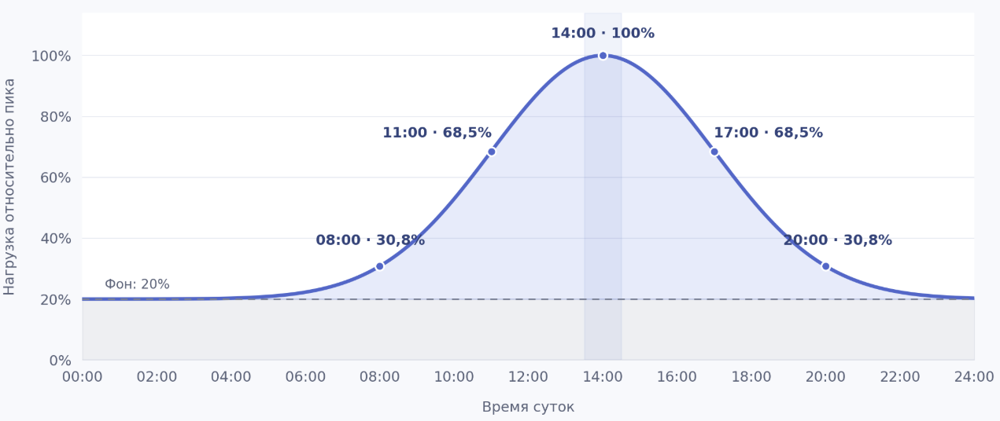
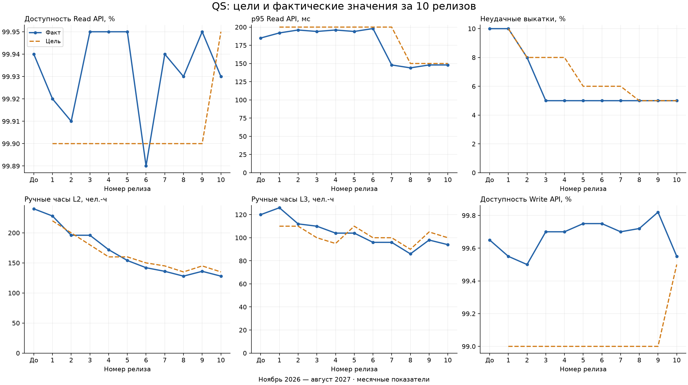

# ПР3

> **Важно: это учебный проект.** В материалах используются общедоступные сведения о Яндексе (Yandex), Yandex Cloud и Monium со ссылками на публичные источники. Оговорка о вымышленности не распространяется на сведения, прямо подтверждённые этими источниками. Все остальные конкретные данные — цены и тарифы, правила, требования, ограничения, показатели, состав команд, архитектура, процессы, SLA/SLO, сроки и компенсации — являются вымышленными условиями учебного сценария. Авторские расчёты, оценки, таблицы и иллюстрации на основе публичных данных также являются учебными и не подтверждают реальные показатели или обязательства компании и сервиса. Материалы не являются официальной документацией или заявлениями Яндекса, Yandex Cloud и Monium. Формулировки «мы», «наш сервис» и подобные относятся к участникам учебного сценария.

## Паспорт

### Компания и продукт

Yandex

Observability платформа Monium

https://monium.yandex.cloud

### Тип цифрового бизнеса

Тип: SaaS

Модель монетизации: Pay-per-use

### Выбранный ИТ-сервис

Сервис квотирования - это наш сервис который отвечает за управления всеми доступными пользователю квотами. Этот сервис хранит эти квоты и предоставляет API другим сервисам, для их изменения + получения текущих лимитов и юзаджа. 

На данный момент квота сервис отвечает за квотирование исключительно метрик.

### Годовой оборот и способ подтверждения

Мы тарифицируем пользователей: 
- по использованию метрик (объем хранения шт, величина потока на запись шт\с)
- по записи логов \ трейсов в секунду (объем ГБ)
- по числу вычисляемых алертов и сработавших эскалаций

Для учебного расчёта используются [публичные тарифы Monium](https://yandex.cloud/ru/docs/monium/pricing) и опубликованные показатели нагрузки (см. раздел «Пользователи и нагрузка»). Сам расчёт и его допущения являются авторской учебной моделью.

Для условной оценки выручки опубликованные значения приняты за пиковые. Это допущение учебного расчёта; предполагаемый профиль нагрузки представлен на иллюстрации:

Расчёт по публичным тарифам с принятым учебным профилем нагрузки даёт условную выручку около 15 млрд в год. Это результат авторской модели, а не опубликованная финансовая статистика или подтверждённая реальная выручка Monium.

### Пользователи и нагрузка

По сути сервисом опосредовано пользуются все, как и внешние клиенты, которые записывают в нас телеметрию, так и соседнии с нами сервисы, для того чтобы ограничивать те или иные потоки данных исходящие от клиентов на основе выставленных для них лимитов.

MAU 16.000 пользователей

3.000.000.000 семплов метрик в секунду

44.000.000 миллионов спанов в секунду

60ГБ/c обрабатываем логов

Источник показателей пользователей и нагрузки: [публичная страница команды Monium](https://yandex.ru/jobs/services/cloud/monium). Использование этих показателей как пиковых в расчёте выручки — отдельное учебное допущение.

### Режим данных

Наши данные - это телеметрия, мы занимаемся ее сбором (свои агенты, фетчеры), приемкой (инжест), обработкой (временные рядя, логи, трейсы) и выстраиванием платформы поверх этих данных (считаем алерты, SLO, рисуем дашики, графики, итд итп). Это если говорить про весь продукт в целом.

Конкретно в QS данные телеметрии мы не храним и не обрабатываем, тут данные - это деревья квот, где по каждому проекту, шарду мы храним узлы с потреблением и лимитами квот.

## Начальная команда

| ITIL роль / позиция | Численность для QS | Зона ответственности | Стоимость полной ставки, ₽/чел.-мес. |
| --- | --- | --- | --- |
| Service owner, Change authority / лид QS | 1 | Архитектура, приоритеты, ресурсы и согласование | 450 000 |
| Technical specialist L3 / senior backend | 1 | Сложные изменения, расследования и ревью | 350 000 |
| Technical specialist L3 / middle backend | 2 | API, автоматизация, диагностика и исправления | 280 000 |
| Technical specialist / junior backend | 1 | Скрипты, автотесты и небольшие задачи под ревью | 180 000 |
| Service desk agent, Technical specialist L2 / поддержка L1/L2 | 2* | Обращения, инструкции и диагностика L2 | 120 000 |
| Problem manager, специалист по мониторингу, Service level manager, Capacity and performance manager, Deployment manager / SRE | 1* | Проблемы, мониторинг, SLA, мощность и выкатки | 280 000 |
| Change coordinator / менеджер продукта | 1 человек, 25% | Требования, координация, расписание и уведомления | 400 000 |

\* Это месячный ресурс общих команд: 2 ставки поддержки и 1 ставка SRE, распределённые между сотрудниками, обслуживающими также другие сервисы Monium. Всего на QS — 8,25 ставки. Incident manager — текущий дежурный QS, отдельной ставки нет. QS предоставляет API; разработка UI в состав команды не входит.

Полная ставка — 160 ч в месяц; стоимость часа равна стоимости ставки / 160. Базовая стоимость команды — 2 160 000 ₽/мес., доступно 1 320 чел.-ч, из них 800 ч команды QS, 320 ч поддержки, 160 ч SRE и 40 ч продукта. Часы L3 занимают часть 800 ч разработки; L2 — часть ресурса поддержки. Распределение по линиям не создаёт дополнительной мощности. Изменения состава и доступности указываются в плане соответствующего релиза.

На старте 1 600 активных проектов и 8 000 шардов; в наиболее нагруженной зоне средний / пиковый Read RPS — 180 000 / 360 000, Write RPS — 2 000 / 4 000. На начало цикла открыты 52 проблемы. Фактическая нагрузка и ресурсные ограничения каждого месяца фиксируются в сводках релизов.

## Метрики

| Метрика | Единица | Расчёт и окно | Начальная цель | Исходный факт |
| --- | --- | --- | --- | --- |
| R: доступность Read API | % | Успешные / все учитываемые запросы × 100%, месяц, по зоне | ≥ 99,9 | 99,94 |
| p95 Read API | мс | Перцентиль успешных запросов, месяц, по зоне | ≤ 200 | 185 |
| F: неудачные выкатки | % | Неудачные / все выкатки × 100%, включая минорные | ≤ 10 | 10: 2 из 20 |
| L2: ручные часы L2 | чел.-ч | Фактическое ручное время за месяц | ≤ 220 | 240 |
| L3: ручные часы L3 | чел.-ч | Фактическое ручное время за месяц | ≤ 110 | 120 |
| W: доступность Write API | % | Успешные / все учитываемые запросы × 100%, месяц, по зоне | ≥ 99 | 99,65 |

Исходный факт — показатели месяца до релиза 1. В общей таблице для API показываем худшее значение среди зон; в планах указываем соответствующую зону. Цели таблицы — внутренний контракт команды; клиентские гарантии ПР1 продолжают действовать. Более строгие p95 с R8 и доступность с R10 являются внутренними SLO. Пересмотр клиентского SLA требует согласования по ПР2 минимум за 2 недели; завершённые периоды не пересчитываются. Внутренние цели L2/L3 с R5 пересмотрены на планировании 15.02.2027 по результатам R1–R3 и прогнозу нагрузки.

Правила учёта сохраняем на весь цикл:

- API: ошибки, таймауты, влияние работ и зависимостей учитываем по [SLA ПР1](../task1.md). Доступность считаем из суммарного числа запросов зоны, p95 — по объединённым гистограммам её реплик. Проценты и перцентили нод не усредняем. При отсутствии запросов или данных указываем «нет данных».
- Выкатки: учитываем мажорные, минорные и экстренные выпуски. Одна версия, последовательно развёрнутая по хостам и зонам, — одна выкатка. Неудачная выкатка вызывает связанный с ней инцидент либо требует отката или экстренного исправления дефекта; несколько последствий считаем один раз. Откат относится к исходной выкатке, новая исправленная версия — отдельная выкатка. При отсутствии выкаток долю не рассчитываем.
- Ручные часы: отдельно суммируем фактическое время L2 и L3 на обращения, отказы автоматизации, обходы, восстановление и ручное сопровождение. Два инженера по часу — 2 чел.-ч; ожидание не включаем, одни и те же часы не дублируем. Разработку, тестирование и внедрение учитываем отдельно в стоимости релиза.

## Расписание релизов

Итерация — календарный месяц, поэтому длительность составляет 4–4,4 недели. В каждом месяце один мажорный выпуск и минорные выкатки по готовности. Последовательность метрик в ячейках: R / p95 / F / L2 / L3 / W; единицы — % / мс / % / ч / ч / %. Отклонение = факт − цель; для процентов — п.п. Положительное отклонение благоприятно для R/W, отрицательное — для остальных показателей. В составе работ указан исходный план; его изменения описаны после события в соответствующем релизе. Роли и часы раскрыты в подробном плане.

| Номер и горизонт релиза | Цель релиза | Состав работ | SLA целевой | SLA фактический | Отклонение | Подробный план |
| --- | --- | --- | --- | --- | --- | --- |
| 1; ноябрь 2026; 4,3 нед. | Самостоятельная настройка лимитов шардов; меньше ручных часов L2/L3 | API лимитов; совместимость и мощность; проблемы; проверки и массовая выгрузка (QS, SRE, поддержка, продукт) | 99,9 / 200 / 10 / 220 / 110 / 99 | 99,92 / 192 / 10 / 228 / 126 / 99,55 | +0,02 / −8 / 0 / +8 / +16 / +0,55; Авария диагностики добавила 16/24 ч L2/L3 | [1.md](1.md) |
| 2; декабрь 2026; 4,4 нед. | Автораспределение квот; меньше ручных часов L2/L3 | Планировщик; одиночный и пакетный расчёт; профилактика; мощность и выпуск (QS, SRE, поддержка, продукт) | 99,9 / 200 / 8 / 200 / 110 / 99 | 99,91 / 196 / 8 / 196 / 112 / 99,5 | +0,01 / −4 / 0 / −4 / +2 / +0,5; Клиент ускорил миграцию и рассчитывал на межпроектную автораздачу; +24/28 ч L2/L3 | [2.md](2.md) |
| 3; январь 2027; 4,4 нед. | Шаблоны новых проектов; меньше ручных часов L2/L3 | Шаблоны; Project Manager и поток изменений; мощность и профилактика (QS, SRE, поддержка, продукт) | 99,9 / 200 / 8 / 180 / 100 / 99 | 99,95 / 194 / 5 / 196 / 110 / 99,7 | +0,05 / −6 / −3 / +16 / +10 / +0,7; Внеплановый аудит добавил 24/28 ч L2/L3 | [3.md](3.md) |
| 4; февраль 2027; 4,0 нед. | История и диагностика API; меньше ручных часов L2/L3 | История; диагностика; мощность, аудитный пакет и экспорт (QS, SRE, поддержка, продукт) | 99,9 / 200 / 8 / 160 / 95 / 99 | 99,95 / 196 / 5 / 172 / 104 / 99,7 | +0,05 / −4 / −3 / +12 / +9 / +0,7; В личных переписках обнаружены неучтённые обязательства; +24/24 ч L2/L3 | [4.md](4.md) |
| 5; март 2027; 4,4 нед. | Предупреждения о квотах; меньше ручных часов L2/L3 | Пороги и прогноз; доставка; мощность; проблемы и профилактика (QS, SRE, поддержка, продукт) | 99,9 / 200 / 6 / 160 / 110 / 99 | 99,95 / 194 / 5 / 154 / 104 / 99,75 | +0,05 / −6 / −1 / −6 / −6 / +0,75; Общие смены отданы другой миграции; прогноз снят, выпуск перенесён | [5.md](5.md) |
| 6; апрель 2027; 4,3 нед. | Автодогон репорта в биллинг; меньше ручных часов L2/L3 | Догон репорта; сверка и повтор; мощность, старая история и профилактика (QS, SRE, поддержка, продукт) | 99,9 / 200 / 6 / 150 / 100 / 99 | 99,89 / 198 / 5 / 142 / 96 / 99,75 | −0,01 / −2 / −1 / −8 / −4 / +0,75; Обычные изменения проводят как срочные; неготовый выпуск вызывает P1 | [6.md](6.md) |
| 7; май 2027; 4,4 нед. | Жадный кеш деревьев; снижение p95 Read | Кеш; актуальность; прогрев и мощность; профилактика (QS, SRE, поддержка, продукт) | 99,9 / 200 / 6 / 145 / 100 / 99 | 99,94 / 148 / 5 / 136 / 96 / 99,7 | +0,04 / −52 / −1 / −9 / −4 / +0,7; Единственный специалист одновременно ведёт P1; диагностика задерживается | [7.md](7.md) |
| 8; июнь 2027; 4,3 нед. | Отселение горячих деревьев; p95 Read ≤150 мс | Выделенные ноды; прогрев и перенос; 40 отселений; профилактика (QS, SRE, поддержка, продукт) | 99,9 / 150 / 5 / 135 / 90 / 99 | 99,93 / 144 / 5 / 128 / 86 / 99,72 | +0,03 / −6 / 0 / −7 / −4 / +0,72; Изоляция дала 144 мс; отказ NIC добавил 22/22 ч L2/L3 | [8.md](8.md) |
| 9; июль 2027; 4,4 нед. | Квоты логов через API; меньше ручных изменений L2/L3 | Квоты логов; интеграция; мощность и пилот 400 проектов; профилактика (QS, SRE, поддержка, продукт) | 99,9 / 150 / 5 / 145 / 105 / 99 | 99,95 / 148 / 5 / 136 / 98 / 99,82 | +0,05 / −2 / 0 / −9 / −7 / +0,82; Клиенту обещан общий пул, которого нет в согласованном объёме; пилот ограничен | [9.md](9.md) |
| 10; август 2027; 4,4 нед. | Восстановление после потери зоны; R/W ≥99,95/99,5% | Снимок и журнал; мощность и два учения; проблемы; инструкции и SLA (QS, SRE, поддержка, продукт) | 99,95 / 150 / 5 / 135 / 100 / 99,5 | 99,93 / 148 / 5 / 128 / 94 / 99,55 | −0,02 / −2 / 0 / −7 / −6 / +0,05; Поставщик: Read SLO не выполнен, P1 98 мин вместо 70 | [10.md](10.md) |

## Анализ динамики

За 10 месяцев ручная L2 сократилась с 240 до 128 ч, L3 — со 120 до 94 ч. Вместе это 222 вместо 360 ч, на 38,3% меньше. При этом число проектов выросло с 1 600 до 2 600 (+62,5%), шардов — с 8 000 до 14 200 (+77,5%), средний зональный Read RPS — на 69,4%, Write — на 80%. Мы обслуживаем больший объём прежним составом, но свободные часы ещё не означают сокращение расходов: все 8,25 ставки оплачиваются полностью.

Синяя линия — факт, пунктир — цель соответствующего месяца; «До» — исходный месяц. Доступность показана по худшей зоне, p95 — по зоне с наибольшим месячным перцентилем; эти зоны могут различаться. Дельты к предыдущему месяцу и сводки инцидентов, работ и затрат приведены в конце каждого подробного плана.

### Ручная работа и пересмотр целей

В R1–R4 бюджет L3 превышен каждый месяц, L2 — в трёх месяцах из четырёх. Например, в R1 самообслуживание экономит на сопоставимом объёме 69 ч L2 и 19 ч L3, но лебедь возвращает 16/24 ч, плюс меняется обычная нагрузка. Поэтому по итоговым часам нельзя приписывать весь выигрыш новой функции. В R4 диагностика снимает 36/22 ч на сопоставимых операциях, а обнаруженные обещания в личных переписках требуют 24/24 ч. Из них 4/8 ч — восстановленный учёт уже выполненной февральской работы; остальные часы уходят на разбор и исполнение обязательств. Факт 172/104 выше цели 160/95, и часть изменения объясняется полнотой учёта, а не скоростью инженеров.

На планировании 15.02.2027 мы пересматриваем будущие бюджеты L2/L3 с R5: учитываем результаты R1–R3, промежуточный февраль и обязательную профилактику. Полного результата R4 на эту дату ещё нет. Цели завершённых месяцев сохраняются. С R5 часы укладываются в новые бюджеты, однако это результат и автоматизации, и более реалистичного планирования. В R9 лимиты часов увеличены со 135/90 до 145/105 из-за подключения логов; фактические 136/98 хуже июньских 128/86, хотя цель выполнена. Расширение пилота с 200 до 400 проектов переносится, освобождая 44 ч QS. Долг остаётся в следующем цикле.

В R5 отдельно видна цена общего ресурса: 104 ч поддержки и SRE переназначены на другую миграцию Monium. Для QS остаются 1 216 вместо 1 320 ч, из них заняты 1 060. Часы поддержки и SRE в нужном окне нельзя заменить общим остатком разработчиков, поэтому снимаем прогноз исчерпания на 36 ч и переносим выпуск на четыре дня. Бюджеты L2/L3 выполнены, но обещанный объём и срок не сохранены.

### Задержка и доступность

До R7 p95 держится в пределах 192–198 мс, близко к границе 200 мс. Жадный кеш снижает его со 198 до 148 мс при растущем числе деревьев. Отселение горячих деревьев в R8 даёт 144 мс и позволяет ввести внутреннюю цель 150 мс; подключение логов и последующие события поднимают факт до 148 мс, запас остаётся 2 мс. За это платим памятью, выделенными нодами и проверками актуальности. Память QS в R7 стоит дополнительно 120 тыс. ₽/мес., hot-ноды R8 — 360 тыс. ₽/мес.; ещё 80 тыс. ₽/мес. R7 относятся к Write/YDB. Ускорение Read не устраняет отказы записи и внешних зависимостей.

Клиентская месячная доступность Read нарушена в R6: 99,89% против 99,9%, отклонение −0,01 п.п. Все месячные значения Write выполняют договорную цель 99%; это не делает аварии незаметными. В R10 выясняется, что круглосуточная регистрация у поставщика не означает круглосуточную работу инженера. Команда восстанавливает сервис самостоятельно за 98 минут при договорных 70, нарушение — 28 минут. Месячная доступность при этом выполнена. Поэтому число и разбор инцидентов нужны рядом с шестью метриками. Внутренняя цель Read R10 99,95% не достигнута на 0,02 п.п.; Write 99,55% выполняет усиленную цель 99,5%, хотя хуже июльских 99,82%. Внешние гарантии ПР1 не менялись, санкции за внутренний SLO не начисляем.

В R7 полное восстановление укладывается в 70 минут, но расследование занимает 31 минуту при внутреннем ориентире 15: специалист был занят координацией аварии. В R9 все шесть целей выполнены, однако клиенту обещали общий пул, которого согласованный API не предоставлял. Команде нужны ручной обход и коммерческая уступка. Эти ситуации нельзя оценить только по зелёной строке месячных показателей.

### Выкатки, техработы и проблемы

Доля неудачных выкаток снижается с 10% в R1 до 8% в R2 и 5% с R3. Всего 12 неудачных из 205 выкаток — 5,85%; доли месяцев для этого не усредняем. В R7 неудачным оказался мажор, в остальных месяцах — миноры. Одинаковые 5% поэтому не означают одинаковые последствия для выпуска. В R6 одна неудача дополнительно раскрыла систематический обход обычного согласования через срочный маршрут: процент успешных версий сам по себе не показывает соблюдение процедуры.

Ниже контекст для объяснения динамики, без добавления новых сквозных метрик. Техработы — зарегистрированные протоколы с ожидаемым или фактическим влиянием; обычная выкатка автоматически ими не считается. В R8–R9 четыре зональных этапа имеют отдельные протоколы, поэтому рост их числа сам по себе не означает ухудшение качества.

| Релиз | Неудачные / все выкатки | Техработы: плановые / экстренные | Инциденты P1 / P2 | Открытых проблем на конец | Входящая профилактика: разовая / регулярная, ч |
| --- | --- | --- | --- | --- | --- |
| 1 | 2 / 20 | 1 / 2 | 1 / 1 | 48 | 0 / 0 |
| 2 | 2 / 25 | 0 / 1 | 0 / 1 | 44 | 84 / 0 |
| 3 | 1 / 20 | 1 / 1 | 0 / 1 | 40 | 60 / 0 |
| 4 | 1 / 20 | 1 / 0 | 0 / 1 | 36 | 40 / 4 |
| 5 | 1 / 20 | 0 / 1 | 0 / 1 | 33 | 54 / 4 |
| 6 | 1 / 20 | 1 / 1 | 1 / 0 | 30 | 60 / 8 |
| 7 | 1 / 20 | 2 / 1 | 1 / 1 | 29 | 56 / 20 |
| 8 | 1 / 20 | 5 / 1 | 1 / 1 | 28 | 62 / 30 |
| 9 | 1 / 20 | 5 / 0 | 0 / 2 | 26 | 62 / 30 |
| 10 | 1 / 20 | 3 / 1 | 1 / 1 | 24 | 62 / 34 |

За цикл — 5 P1 и 10 P2. При этом требование доказательств доступа в R3, обнаружение личных обещаний в R4 и перераспределение смен в R5 сами по себе не объявляются авариями API. Два основных лебедя связаны с техническими неисправностями, остальные — с решениями клиентов, требованиями контроля, организацией работы и условиями поставщика. Подготовка к гонкам квот не создаёт порядок согласования миграции, а успешное дневное учение не проверяет полномочия ночной смены поставщика.

Очередь проблем сократилась с 52 до 24: появилось 22 новых причины, 50 закрыты после проверки. Закрытие теперь опирается и на технический результат, и на подтверждённую передачу ответственности: паспорт миграции, разрешённого получателя доказательств, закреплённую смену, обоснование экстренности, заместителя при аварии и границы обещаний клиенту. Эти проверки тоже занимают ресурс следующих месяцев.

### Цена результата и следующий цикл

Разовые пакеты профилактики передаются между релизами, регулярная нагрузка вырастает до 34 ч/мес. на входе R10. На следующий цикл остаются 118 ч разовых мер и уже 44 ч/мес. регулярных проверок, отдельно — 44 ч QS на расширение пилота логов. Эти часы находятся внутри оплаченных ставок и конкурируют с новой разработкой; повторно к фонду 2,16 млн ₽ их не прибавляем. Ограничение проверяем по каждому исполнителю: например, в R7 оба middle заняты по 160 ч, хотя у других позиций ещё есть резерв. Свободные часы поддержки или junior не заменяют время middle.

Постоянные инфраструктурные доплаты вырастают с 180 тыс. ₽/мес. после R1 до 1,61 млн ₽/мес. после R10. Это накопленные расходы сверх исходного размещения, стоимость которого не оценена. В R10 фонд, доплаты и разовые ресурсы дают 3,87 млн ₽, с сервисным кредитом — 3,93 млн ₽ экономической нагрузки. Часы внедрения оплачены заранее: например, R1 требует 538 ч автоматизации и совместимости против 88 ч экономии в первом месяце; R6 — 490 ч против 62 ч на сопоставимых сверках. По этим данным окупаемость ещё не доказана. В расчёте окупаемости учитываем последующие объёмы операций, постоянные проверки и инфраструктуру. Разовое уменьшение ручных часов нельзя переносить на весь горизонт без проверки спроса.

В мартовском учёте различаем полный оплаченный фонд и атрибуцию услуг: из 2,16 млн ₽ труда 118 тыс. ₽ относятся к другой миграции Monium. Полный расход с инфраструктурой и кредитом — 2,73 млн ₽, доля QS — 2,612 млн ₽. Переназначение не создаёт новых бесплатных часов, эти два среза не складываем.

При конфликте продуктового объёма и эксплуатации Service owner принимает решение вместе с продуктом и SRE и фиксирует снятые задачи, стоимость и получателя долга. Change authority сохраняет остановку небезопасной выкатки; при активном инциденте решения по восстановлению ведёт дежурный Incident manager. Принятые обязательства восстановления и профилактика предыдущих аварий получают ресурс раньше необязательного расширения. Предлагаем закрепить в регламенте это правило приоритетов и единый акт проверки полного восстановления.
