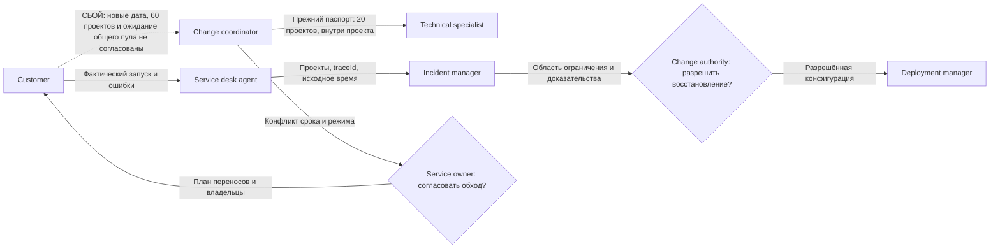

# Передача требований и SLA: R1 → R2

**Это передача после инцидента.**

17 ноября утечка соединений диагностической выгрузки вызвала P1 и сдвинула выпуск с 18 на 20 ноября. Сервис восстановили за 54 минуты, а затем исправили код. Однако для закрытия проблемы ещё нужно проверить длительную работу диагностики и передать инструкции поддержке. Эти работы занимают 84 часа и переходят в декабрь со сроком до 7 декабря.

## 0. Паспорт и состояние документа

Документ описывает передачу QS из ноябрьского релиза R1 в декабрьский R2 за 2026 год во всех четырёх зонах a/b/d/e. Версия документа 1.0 содержит состояние на 1 декабря и результаты на 31 декабря. Его статус «Результат зафиксирован» означает, что итоги выпуска записаны, но не заменяет подтверждения согласующих.

Документом владеет Change coordinator. Technical specialist R1 и Problem manager передают работы, Technical specialist R2 принимает техническую часть, а Service owner подтверждает ресурс. Назначения заместителей и подтверждения согласования пока не приложены. Основанием служат отчёты [R1](../task3/1.md) и [R2](../task3/2.md), [SLA сервиса](../task1.md#учебный-sla-для-вымышленного-сценария-monium) и [регламент передачи](../task2.md#передача-требований-и-sla-между-релизами).

## 1. Общая цель

В R1 пользователь получил возможность самостоятельно менять лимиты шардов. В R2 команда добавляет автораздачу, которая находит свободный лимит и переносит его между шардами одного проекта. Проектная квота при этом не увеличивается. Межпроектная автораздача и UI в этот выпуск не входят.

Команда планирует подключить до 360 проектов. Сначала владелец проверяет расчёт без применения изменений через dry-run, затем явно включает автоматику. Обязательными остаются права доступа, свежесть потребления, защита от повторов и профилактика ноябрьской утечки. Пакетный просмотр нескольких проектов можно перенести, если времени не хватит.

Цель по ручному сопровождению составляет не более 200 часов L2 и 110 часов L3 против ноябрьских 228 и 126 часов. Service owner и поддержка проверяют результат на сопоставимых внутрипроектных переносах. До автоматизации успешная операция требовала в среднем 0,20 часа L2 и 0,10 часа L3. Снижение трудозатрат оценивается по итогам декабря и само по себе не означает денежной окупаемости.

## 2. Что передаётся из предыдущего релиза

Technical specialist принимает работающий API настройки лимитов и общий путь записи. Новая автоматика должна сохранить проверки версий, прав и повторных запросов, чтобы не потерять изменения пользователя.

Problem manager передаёт две открытые проблемы. По P-R1-FD код исправлен 24 ноября, а длительный прогон завершён 27 ноября. До 7 декабря нужно автоматизировать проверки отмены, проверить предупреждение о расходе дескрипторов и закончить семь дней наблюдения. На это выделены 60 часов QS, 16 часов SRE и 8 часов поддержки. Все 84 часа уже включены в третий элемент плана R2. По P-R1-USAGE до 28 декабря нужно получить подтверждение coremon о свежести данных и проверить, что QS отказывает в уменьшении лимита по старому снимку. Эта работа входит в защиту автораздачи без отдельного пакета часов.

На начало декабря в очереди 48 проблем, но полный реестр к передаче не приложен. Среди известных причин есть неполная комплектность служебных сборок. Массовая выгрузка dry-run из R1 на 48 часов остаётся в продуктовой очереди без даты. Это отдельная работа от пакетного просмотра R2 на 44 часа.

Новые регулярные проверки на входе не требуют отдельного пакета часов. Обычная эксплуатация продолжается. QS обслуживает 1 680 проектов и 8 400 шардов, постоянная инфраструктурная доплата составляет 180 000 ₽ в месяц. Превышение ноябрьских целей L2 на 8 часов и L3 на 16 часов остаётся в отчёте. Кредит за позднее уведомление об экстренных работах уже учтён в ноябре, сведений о непогашенном остатке нет.

## 3. Ключевые функции и критерии приёмки

1. **Technical specialist проверяет границы автораздачи вместе с Customer.** Она работает только внутри готового проекта и включается с согласия владельца. Сумма лимитов шардов сохраняется и не превышает проектную квоту.
2. **Другой Technical specialist принимает проверки свежести и конкуренции.** Для уменьшения лимита подходит юзадж не старше 60 секунд. После переноса у донора остаётся запас не менее 10% к потреблению. Цикл запускается не чаще одного раза в пять минут и забирает не больше 10% лимита донора. В 10 000 сочетаний ручной записи, обновления юзаджа и повторов не должно быть потерь изменений. Повтор с теми же параметрами возвращает прежний результат, а с изменёнными параметрами получает отказ. После конфликта версии разрешено не больше трёх попыток с перечитыванием и задержкой.
3. **Customer и Service desk agent принимают одиночный dry-run.** Он показывает доноров, получателей, исходную версию и причины отказа. Права проверяются до применения, а квоты хранения и скорости записи не смешиваются.
4. **Problem manager принимает профилактику P-R1-FD.** После 1 000 отмен число дескрипторов должно возвращаться в пределах 5% исходного значения. При занятии не менее 70% лимита в течение пяти минут должно приходить предупреждение. Семь дней наблюдения по всем зонам не должны показывать роста занятого ресурса.
5. **Capacity and performance manager принимает нагрузочные проверки QS вместе с YDB.** После расширения каждая зона должна выдерживать 560 000 Read и 7 200 Write RPS, а при одной выведенной реплике 480 000 и 6 200 RPS. Отдельно проверяется часовой пик 600 000 Read и 5 000 Write RPS. После отправки обновлений команда ещё час наблюдает их запись.

До расширения Deployment manager начинает выкатку только при нагрузке зоны не выше 360 000 Read и 4 800 Write RPS. Прогноз декабря составляет 390 000 и 4 400 RPS на пике, а января 420 000 и 4 800 RPS. Поэтому расширение нужно завершить до январского роста. После клиентского события команда также проверяет конкуренцию на 12 горячих деревьях, поскольку суммарный RPS не описывает этот риск.

## 4. Целевые метрики SLA и внутренние сроки

| Показатель | Факт R1 | Цель R2 | Факт R2 |
| --- | --- | --- | --- |
| Доступность Read API | 99,92% | Не ниже 99,9% | 99,91% |
| Месячный p95 Read | 192 мс | Не выше 200 мс | 196 мс |
| Доступность Write API | 99,55% | Не ниже 99% | 99,50% |
| Неудачные выкатки | 10% | Не больше 8% | 2 из 25, или 8% |
| Ручная работа L2 | 228 ч | Не больше 200 ч | 196 ч |
| Ручная работа L3 | 126 ч | Не больше 110 ч | 112 ч |

Service level manager считает доступность за месяц отдельно по каждой зоне, а p95 получает из объединённой гистограммы успешных запросов. Deployment manager учитывает неудачные версии, поддержка и Technical specialist записывают фактические ручные часы. Доступность и задержка относятся к клиентскому SLA, доля неудачных выкаток и часы являются внутренними целями.

Сохраняются пределы Read p99 в 500 мс, Write p95 в одну секунду и Write p99 в пять секунд. Не менее 99,9% обновлений должны записываться за час и не менее 99,9% записей должны сохраняться без искажений. До отправки в биллинг выполняется сверка. На реакцию по P1 и P2 отводится до десяти минут, полное восстановление должно завершиться за 70 и 130 минут соответственно. Уведомления о работах и об изменении контракта API проверяются отдельно.

Для следующих передач применяются [внутренние сроки команды](../task2.md#внутренние-сроки-технической-команды). После получения требований Change coordinator проверяет их полноту в течение одного рабочего дня. Когда данные собраны, Technical specialist оценивает задачу за два рабочих дня, а ревью готового изменения занимает не больше одного рабочего дня. Сборка вместе с очередью должна укладываться в 20 минут, обычная выкатка в четыре часа. Длительность миграции команда оценивает отдельно. Deployment manager начинает откат в течение пяти минут после разрешения Change authority и завершает техническое восстановление за 30 минут от того же разрешения.

Два отката образа в R2 заняли по 20 минут, однако журналов для проверки остальных сроков нет.

## 5. Распределение ответственности и ресурса

Change coordinator отвечает за требования, паспорт подключения и уведомления. Customer подтверждает состав проектов, полномочия владельцев и ожидаемый режим. Technical specialist отвечает за реализацию, проверки и безопасный откат. Специалист по мониторингу проверяет сигналы, Problem manager принимает устранение причин, а Capacity and performance manager подтверждает мощность. Service owner решает конфликты ресурса, Change authority разрешает конкретную версию, Deployment manager выполняет выпуск. При инциденте восстановлением руководит Incident manager.

Команде доступны 1 320 часов, фонд составляет 2,16 млн ₽. Исходный план работ занимает 674 часа и уже включает профилактику R1. После клиентского события из него сняты 44 часа пакетного dry-run, поэтому объём работ сократился до 630 часов. С учётом эксплуатации фактически заняты 1 116 часов, свободны 204. Само событие потребовало 24 часа L2, 28 часов L3 и 12 часов SRE. Общий резерв не подтверждает доступность нужного специалиста в конкретное окно, а назначения заместителей пока не приложены.

## 6. Формат, канал и изменения после начала разработки

Change coordinator хранит согласованную версию документа в задаче релиза. На планировании принимающая сторона объясняет, как она понимает границы проекта, свежесть юзаджа и обработку повторов, а Customer подтверждает тот же сценарий. Протокол такого согласования к документу не приложен.

Первоначально мажор стоял на 17 декабря, а миграция «СеверМаркета» на 18 декабря. Клиент собирался создать 20 проектов и 300 шардов с общей квотой записи 3 млн семплов в секунду. 10 декабря выяснилось, что миграция уже началась и вместо 20 проектов создано 60. Повторного допуска изменённой структуры не было. 11 декабря Service owner вместе с продуктом и эксплуатацией перенёс мажор на 21 декабря и снял пакетный dry-run, чтобы закончить восстановление и проверки.

При изменении даты, структуры, владельцев или волн Customer должен передать новые условия Change coordinator до запуска. Команда повторно оценивает затронутые части, а клиент подтверждает поддерживаемый режим. Прежнее разрешение относится только к ранее согласованной области.

## 7. Риски и меры предотвращения

Утечка диагностики может повториться, поэтому Technical specialist и специалист по мониторингу проверяют отмены, алерт и длительный прогон. При повторе Deployment manager останавливает задания и возвращает совместимую версию, сохраняя данные. Problem manager закрывает причину после проверки, а не после одного успешного перезапуска.

Гонки и старый юзадж проверяются конкурентными запросами. При конфликте операция получает отказ и повторяется только после перечитывания. Изменённая миграция требует нового паспорта и проверки горячих деревьев. Если клиентские повторы перегружают сервис, команда ограничивает миграционное задание, сохраняя обычные настройки и передачу потребления coremon.

Deployment manager наблюдает канарейку 15 минут и обновляет зоны последовательно. Сумма сломанных и обновляемых реплик не должна превышать одну. Ошибка контрольной операции, расхождение записи, превышение порогов или отсутствие метрик больше пяти минут останавливают выпуск. Принятые лимиты и юзадж при откате сохраняются.

## 8. Решение о передаче и результат выпуска

P-R1-FD закрыта до 7 декабря, а P-R1-USAGE до 28 декабря после подтверждения coremon и семи дней наблюдения. 21 декабря команда ввела дополнительную мощность и выпустила автораздачу для 360 проектов. Конкурентные и нагрузочные проверки пройдены, но первичные подтверждения принятия плана и допуска к выпуску не приложены.

P2 от 10 декабря восстановлен за 58 минут. Отдельный запрос на 36 межпроектных переносов завершён за 4 часа 20 минут при каталожном сроке восемь часов. За экстренные работы без суточного уведомления начислен кредит 200 000 ₽. Месячные SLA API выполнены, а L3 превысила внутреннюю цель на два часа.

В конце декабря открыты 44 проблемы. В R3 переходит R2-P-MIGRATION на 60 часов со сроком до 12 января. Отдельных новых регулярных часов не добавлено. Пакетный dry-run R2 на 44 часа и массовая выгрузка R1 на 48 часов остаются разными задачами без обещанной даты.

## 9. Сбой коммуникации и корректирующие действия

Клиент ожидал, что свободная квота соседних проектов будет автоматически помогать перегруженным. Команда согласовала перенос только между шардами одного проекта. Когда клиент изменил структуру и дату подключения, это расхождение не проверили повторно. Миграционное задание пыталось исправить лимиты запросами с новыми идентификаторами, создало конкуренцию на 12 деревьях и замедлило работу соседних проектов.

Событие снизило доступность Read зоны a на 0,03 процентного пункта и Write на 0,10 пункта. Они остались в пределах SLA, но ручная работа выросла на 24 часа L2 и 28 часов L3. Месячный p95 при этом не изменился. Эти последствия учитываются отдельно от технической утечки ноября.

Incident manager организовал восстановление API, а Service owner и Customer согласовали ручные межпроектные переносы с подтверждением полномочий владельцев. Проверки суммы, свежести и прав сохранились. Команда перенесла дату и сняла дополнительный объём вместо сокращения проверок. Для следующих подключений Change coordinator проверяет паспорт миграции повторно при изменении условий, а Customer подтверждает границы режима. В январе Problem manager принимает паспорт и учение изменения структуры с 20 на 60 проектов. Только после обеих проверок можно закрыть R2-P-MIGRATION.

## 10. Что упущено и что остаётся неподтверждённым

- **Профилактика R1 не проверяла изменение клиентского подключения.** Она защищала диагностику, поэтому закрытие утечки не подтверждало готовность новой миграции. До следующей волны Change coordinator и Customer должны заново согласовать дату, структуру, владельцев и порядок подключения.
- **Стороны по-разному поняли автораздачу.** Перед новым обещанием даты Technical specialist должен показать Customer допустимый перенос между шардами и отказ при попытке автоматического переноса между проектами. Customer подтверждает, что этого режима достаточно.
- **Общий RPS скрыл конкуренцию на отдельных деревьях.** Capacity and performance manager должен включить такой профиль и ограничение повторов в допуск следующих миграций. В декабре эта проверка появилась только после события.
- **В январском пакете 60 часов нет времени продукта.** Service owner и Change coordinator должны до январской приёмки определить, где учтены согласования с Customer. Если обычной координации не хватит, план нужно пересчитать.
- **Не приложены полный реестр 48 проблем, согласования, уведомления об API, журналы CI и назначения заместителей.** Problem manager, Change coordinator и Deployment manager должны собрать эти сведения до следующего допуска. Пока полнота передачи и выполнение всех внутренних сроков не подтверждены.
- **Две задачи dry-run могут потеряться или попасть в расчёт дважды.** На следующем планировании Change coordinator должен закрепить отдельные ID, объём и приоритет для работ на 48 и 44 часа. Обе остаются без обещанной даты.
