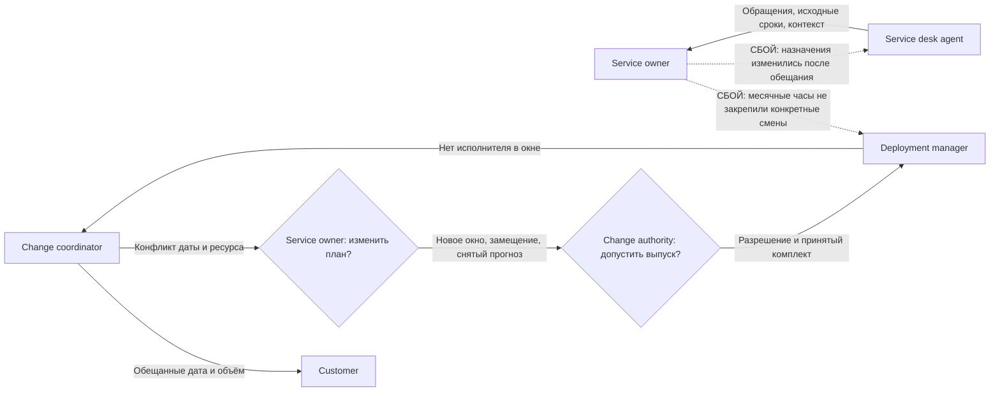

# Передача требований и SLA: R4 → R5

**Это передача в условиях сжатых сроков.**

Проверку передачи незакрытых обязательств нужно закончить к 17 марта, а выпуск предупреждений обещан на 18 марта. Между приёмкой процесса поддержки и запуском остаётся один день. 16 марта выясняется, что часть общих смен отдана другой миграции. За два дня до обещанной даты команда должна заново назначить исполнителей, сохранить поддержку и решить, какой объём она успеет выпустить.

## 0. Паспорт и состояние документа

Документ описывает передачу QS из февральского релиза R4 в мартовский R5 за 2027 год во всех зонах a/b/d/e. Версия 1.0 содержит состояние на 1 марта и результаты на 31 марта. Итоги выпуска зафиксированы, но назначения заместителей и первичные согласования пока не приложены.

Change coordinator владеет документом. Technical specialist R4 и Problem manager передают контракт истории и проблему R4-DIRECT, Technical specialist R5 и Service desk agent принимают свои части, а Service owner подтверждает ресурс. Основанием служат отчёты [R4](../task3/4.md) и [R5](../task3/5.md), [SLA сервиса](../task1.md#учебный-sla-для-вымышленного-сценария-monium) и [регламент передачи](../task2.md#передача-требований-и-sla-между-релизами).

## 1. Общая цель

Команда добавляет предупреждения о приближении к квоте, чтобы владелец проекта успевал изменить лимит до ограничения потока. QS использует сохранённый снимок coremon, а ограничение применяет сервис-потребитель. Само предупреждение не гарантирует, что запись продолжится. UI в объём релиза не входит.

Рабочие цели составляют не более 160 часов L2 и 110 часов L3 против февральских 172 и 104 часов. Допустимую L3 увеличили относительно февральской цели в 95 часов ещё на планировании 15 февраля. Поэтому выполнение нового бюджета нельзя целиком приписывать автоматизации. Service owner и поддержка сравнивают одинаковые операции, а продукт и SRE готовят отчёт за первый полный месяц после запуска к 22 апреля.

В обязательный объём входят пороговые предупреждения, проверка получателя, доставка без потерь и дублей, независимость от биллинга и приёмка R4-DIRECT. Прогноз времени до исчерпания по шести свежим снимкам занимает ещё 36 часов и может быть перенесён. Подключение идёт группами по 20, 100 и 320 проектов. Изначально мажор назначен на 18 марта.

## 2. Что передаётся из предыдущего релиза

Technical specialist принимает работающие историю и диагностику R4. Предупреждения получают только применённые изменения с идентификатором события, проектом, шардом, версией и временем. Отказы и dry-run не должны запускать уведомления.

Problem manager передаёт R4-DIRECT. Общий учёт обращений восстановлен, но ещё нужно проверить, что следующая смена принимает обязательства без прежнего инженера. Внедрение назначено на 10 марта, проверка на 17 марта. Пакет занимает 54 часа: 32 часа QS, 16 часов SRE, 4 часа ручной L2 и 2 часа продукта. Четыре часа L2 уже входят в месячный бюджет поддержки. Приёмка включает десять контрольных запросов и семь дней наблюдения без необъяснённых расхождений.

Разовый R3-AUDIT завершён 15 февраля и повторно не переносится. Его регулярный контроль продолжается и занимает по два часа L2 и L3 в месяц. На конец февраля открыты 36 проблем, но полный реестр к документу не приложен. Большой экспорт истории на 62 часа и массовая выгрузка dry-run на 48 часов остаются в продуктовой очереди без даты. Судьба пакетного dry-run R2 на 44 часа в мартовском плане отдельно не указана.

Известные 28 незакрытых личных обязательств обработаны до 15 февраля. Их не нужно переносить как открытые, но нарушение ожидаемого срока по 20 обращениям остаётся в отчёте и требует проверки по каталогу. Превышение февральских целей на 12 часов L2 и 9 часов L3 тоже сохраняется.

На входе QS обслуживает 2 000 проектов и 10 400 шардов. Проверенная мощность составляет 650 000 Read и 7 500 Write RPS, при одной выведенной ноде 600 000 и 7 000 RPS. Постоянные инфраструктурные доплаты составляют 460 000 ₽ в месяц.

## 3. Ключевые функции и критерии приёмки

1. **Customer и другой Technical specialist принимают поведение порогов.** Предупреждения срабатывают при 80%, 90% и 95% использования. Повтор разрешён после снижения на пять процентных пунктов и нового пересечения, но не чаще одного раза в шесть часов на один порог. Проверяются нулевой лимит, повторы и смена версии.
2. **Technical specialist проверяет свежесть вместе со специалистом по мониторингу.** Снимок старше 15 минут не запускает предупреждение, а диагностика возвращает stale_usage. Перед доставкой worker повторно проверяет версию квоты. Этот предел относится к предупреждениям и не заменяет требование свежести в 60 секунд для уменьшения лимита.
3. **Customer канала уведомлений и Deployment manager принимают доставку.** Перезапуск worker и повтор 10 000 событий не должны приводить к потере или повторному уведомлению получателя. Идентификатор события сохраняется, права получателя проверяются, данные чужого проекта не отправляются.
4. **Customer биллинга подтверждает независимость очередей.** Остановка предупреждений не должна менять позицию репорта или останавливать учёт потребления. Technical specialist проверяет это вместе с повторной доставкой.
5. **Capacity and performance manager принимает нагрузочные тесты с фоном предупреждений.** QS/YDB должны сохранить входную мощность как на полной конфигурации, так и без одной ноды. Дополнительно выполняется часовой тест 600 000 Read и 5 000 Write RPS, после которого сверяются все отправленные обновления.
6. **Problem manager принимает R4-DIRECT.** При смене дежурного сохраняются исходный срок, права, владелец и следующий шаг. Повторное обнаружение запроса не создаёт новую заявку. Отдельно Service owner подтверждает исполнителя и заместителя на всё окно выпуска, а Change authority проверяет это перед разрешением.

Мартовский пик зоны b ожидается на уровне 470 000 Read и 5 200 Write RPS. Это 78,33% и 74,29% оставшейся мощности, поэтому новое расширение в март не включено. Поддержка должна видеть возраст снимков и событий, причины отказов, подтверждения получателя и состояние обеих очередей. Отдельный договорный срок доставки предупреждения пока не согласован.

## 4. Целевые метрики SLA и внутренние сроки

| Показатель | Факт R4 | Цель R5 | Факт R5 |
| --- | --- | --- | --- |
| Доступность Read API | 99,95% | Не ниже 99,9% | 99,95% |
| Месячный p95 Read | 196 мс | Не выше 200 мс | 194 мс |
| Доступность Write API | 99,70% | Не ниже 99% | 99,75% |
| Неудачные выкатки | 5% | Не больше 6% | 1 из 20, или 5% |
| Ручная работа L2 | 172 ч | Не больше 160 ч | 154 ч |
| Ручная работа L3 | 104 ч | Не больше 110 ч | 104 ч |
| Дата мажора | Не применяется | 18 марта | 22 марта |

Service level manager считает доступность и задержки за месяц отдельно по зоне. Для доступности используются запросы, для p95 объединённая гистограмма успешных запросов. Deployment manager учитывает выкатки, а поддержка и Technical specialist записывают ручные часы. Доля неудачных выкаток и часы относятся к внутренним целям. Дата мажора является продуктовым обещанием.

Сохраняются Read p99 не выше 500 мс, Write p95 не выше одной секунды и p99 не выше пяти секунд. Не менее 99,9% обновлений должны записываться за час и не менее 99,9% записей должны сохраняться без искажений. Перед биллингом выполняется сверка. Реакция P1/P2 занимает до десяти минут, полное восстановление должно укладываться в 70 и 130 минут. Сроки уведомления о работах и об изменении контракта API действуют отдельно.

Для следующих передач применяются [внутренние сроки команды](../task2.md#внутренние-сроки-технической-команды). После получения требований Change coordinator проверяет их полноту в течение одного рабочего дня. Когда данные собраны, Technical specialist оценивает задачу за два рабочих дня, а ревью готового изменения занимает не больше одного рабочего дня. Сборка вместе с очередью должна укладываться в 20 минут, обычная выкатка в четыре часа. Длительность миграции команда оценивает отдельно. Deployment manager начинает откат в течение пяти минут после разрешения Change authority и завершает техническое восстановление за 30 минут от того же разрешения.

Журналов этих интервалов для R5 нет. Ожидание доступной смены фиксируется отдельно от исполнения.

## 5. Распределение ответственности и ресурса

Change coordinator ведёт требования, обещанный состав и дату, Customer принимает свой сценарий. Technical specialist отвечает за реализацию и проверки, специалист по мониторингу за наблюдаемость, а Capacity and performance manager за нагрузку. Problem manager принимает R4-DIRECT. Service owner вместе с руководителями общих команд подтверждает смены. Change authority разрешает выпуск, Deployment manager исполняет его. Текущий дежурный QS остаётся Incident manager для аварий.

Изначально доступно 1 320 часов при фонде 2,16 млн ₽. Основные работы занимают 534 часа, пакет R4-DIRECT учитывается отдельно. С 16 по 26 марта другой миграции переданы 64 часа поддержки и 40 часов SRE, поэтому QS остаётся 1 216 часов. Прогноз исчерпания на 36 часов заменён комплектом передачи на те же 36 часов, но распределение работы по людям изменилось.

Фактически занято 1 060 часов, свободно 156. При этом SRE занят на 116 часов из доступных 120, а поддержка на 244 из 256. Свободные часы разработчиков не позволяют провести выкатку без нужной смены SRE.

## 6. Формат, канал и изменения после начала разработки

Change coordinator хранит принятую версию документа в задаче релиза. На планировании команда сверяет контракт истории, пороги, права получателя и состояние R4-DIRECT. Принимающие разбирают ошибочный и граничный сценарии. Руководители общих команд подтверждают конкретные окна и замещение. Протокол этой передачи пока не приложен.

16 марта в 09:00 продукт получает новое расписание и узнаёт о потере части смен. К 11:00 Service owner вместе с руководителями поддержки, SRE и продуктом определяет оставшийся ресурс и владельцев открытых запросов. Продукт сообщает владельцам проектов новую дату выпуска. В период с 16 по 19 марта команда готовит комплект передачи, исключает прогноз исчерпания и переносит мажор на 22 марта. Перед выпуском снова подтверждаются присутствие SRE и замещение на всё окно.

Изменение назначения общей смены требует пересмотра принятого плана. Change coordinator уведомляет участников, Service owner меняет распределение работы, а Change authority подтверждает новый допуск. При смене исполнителя обращение сохраняет исходный срок и диагностический контекст.

## 7. Риски и меры предотвращения

Около порога потребление может колебаться, поэтому Technical specialist проверяет гистерезис и ограничение повторов. Старый снимок должен приводить к stale_usage, а не к ложному предупреждению. Если доставка работает неверно, Deployment manager может остановить её, сохранив очередь и работу биллинга.

При конфликте общих смен Service owner должен закрепить исполнителей для поддержки и выпуска до возобновления запуска. Service desk agent передаёт каждому новому владельцу права, исходный срок, проверенную версию и следующий шаг. Problem manager проверяет, что эта передача работает без участия прежнего инженера.

Deployment manager наблюдает канарейку 15 минут, затем последовательно проходит зоны b/a/d/e. Одновременно недоступна или обновляется не более одной ноды. Ошибка контрольной операции, нарушение порогов или отсутствие метрик больше пяти минут останавливает выпуск. При возврате кода сохраняются события и принятый юзадж, позиции предупреждений и биллинга остаются раздельными.

## 8. Решение о передаче и результат выпуска

R4-DIRECT внедрена 10 марта и закрыта Problem manager 17 марта после проверок. Это подтвердило передачу зарегистрированных обязательств, но не решило дефицит людей. R5-STAFF остаётся отдельной открытой проблемой.

Нагрузочные проверки 12 марта пройдены, перед выпуском 22 марта повторены контрольная операция и проверка конфигурации. Двенадцать сценариев порогов, свежести и версий прошли успешно. Повтор 10 000 событий не дал потерь или дублей уведомлений. Пороговые предупреждения подключены для 320 проектов, прогноз исчерпания не выпущен.

За остаток месяца отправлены 1 400 уникальных предупреждений. Из них 1 392 доставлены за 15 минут, ещё восемь за 30 минут. Поскольку отдельная цель доставки не задана, эти восемь случаев нельзя автоматически считать нарушением SLA. Все шесть месячных целей выполнены. Отдельный технический P2 сериализации больших деревьев восстановлен за 40 минут, а кредит 20 000 ₽ начислен за уведомление о его экстренных работах. Этот инцидент не вызван перераспределением смен.

На конец марта остаются 33 проблемы. В R6 переходит R5-STAFF на 60 часов до 9 апреля, включая восемь часов ручной L2. Регулярные проверки увеличиваются с четырёх до восьми часов в месяц. Прогноз на 36 часов, экспорт на 62 часа и массовая выгрузка на 48 часов остаются без даты. Первичные подтверждения согласования к документу не приложены.

## 9. Сбой коммуникации и корректирующие действия

Продукт и Service owner рассчитывали на месячные доли поддержки и SRE, но конкретные смены назначались отдельно. Руководитель общей команды отдал окно другому обязательству, не пересогласовав план с QS заранее. Продукт узнал об этом за два дня до выпуска. В результате 52 обращения пришлось повторно передать, а для 24 из них снова привлекать L3 и восстанавливать ход диагностики.

Повторные передачи добавили 26 часов L2 и 24 часа L3. Без события месячные затраты составили бы 128 и 80 часов, фактически получились 154 и 104 часа. Внутренние цели 160 и 110 часов всё равно выполнены. API не деградировал, а каталожные сроки обращений соблюдены. Нарушено обещание выпустить согласованный объём 18 марта.

Service owner закрепил исполнителей и замещение, команда сохранила проверки прав и доставки, но перенесла дату и сняла прогноз. Для следующих выпусков общие смены подтверждаются до обещания срока, а их изменение требует повторного согласования. При передаче обращения принимающий подтверждает контекст и следующий шаг. В апреле Problem manager должен проверить обычную передачу, отсутствие исполнителя и конкурирующее назначение. Возврат часов 1 апреля сам по себе не закрывает R5-STAFF.

## 10. Что упущено и что остаётся неподтверждённым

- **Между приёмкой R4-DIRECT и обещанным выпуском был только один день.** План не объяснял, что делать при провале проверки. До следующего обещания даты Service owner и Change coordinator должны определить, какой объём переносится и сколько времени остаётся на повторную приёмку.
- **Месячные ставки приняли без подтверждения смен.** Service owner вместе с руководителями общих команд должен закрепить окна и замещение. Проверка конфликта назначений входит в R5-STAFF и должна завершиться до 9 апреля.
- **Видимость заявки приняли за достаточное условие передачи.** Problem manager должен отдельно проверять полноту контекста и доступность исполнителя. Первая проверка завершена в марте, вторая остаётся на апрель.
- **Для предупреждений не согласован срок доставки.** Customer канала и Service level manager должны определить цель, начало и конец отсчёта, а также допустимую нагрузку до нового клиентского обещания.
- **Рост доли автоматических операций не подтвердил экономию.** С учётом повторных передач мартовский результат сопоставимой группы отрицателен. Service owner и Change coordinator должны учесть всю передачу в отчёте к 22 апреля. Окупаемость пока не подтверждена.
- **Не приложены полный реестр задач, назначения смен, журналы CI и все уведомления.** Change coordinator, Problem manager и Deployment manager должны сверить их при следующем планировании. Нужно также установить судьбу пакетного dry-run R2 на 44 часа, который не прослеживается в текущем плане.
