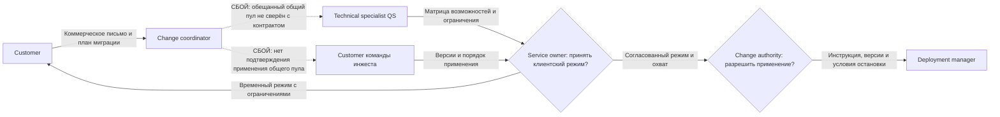

# Передача требований и SLA: R8 → R9

**Это спокойная плановая передача.**

На границе июня и июля нет активного инцидента или внезапного сокращения окна. Новый вид квот согласован 28 июня с запуском 15 июля. Профилактика после R8 назначена до 7 июля, нагрузочные проверки на 12-14 июля. Команда заранее знает объём и ограничения. Позднейший конфликт коммерческого обещания разобран отдельно, поскольку он возник уже после запуска пилота.

## 0. Паспорт и состояние документа

Документ описывает передачу QS из июньского релиза R8 в июльский R9 за 2027 год во всех зонах a/b/d/e. До R9 сервис работал с квотами метрик, затем начался ограниченный пилот квот логов. Версия 1.0 содержит состояние на 1 июля и результаты на 31 июля. Итоги выпуска зафиксированы, но назначения заместителей и подтверждения согласования пока не приложены.

Change coordinator владеет документом. Technical specialist R8 и Problem manager передают контракты и незавершённые работы. Technical specialist R9 и Customer смежных сервисов принимают свои части, а Service owner подтверждает ресурс. Основанием служат отчёты [R8](../task3/8.md) и [R9](../task3/9.md), [SLA сервиса](../task1.md#учебный-sla-для-вымышленного-сценария-monium) и [регламент передачи](../task2.md#передача-требований-и-sla-между-релизами).

## 1. Общая цель

Пользователь должен получить API для изменения скорости приёма логов в байтах в секунду и объёма хранения в байтах. Свободный лимит можно переносить между шардами одного проекта, а предупреждения помогают заметить приближение к квоте. QS хранит лимиты, инжест применяет их, coremon считает исходное потребление, биллинг выставляет счета.

Команда планирует подключить 200 проектов 15 июля и расширить пилот до 400 к 28 июля, если потребители и мощность будут готовы. В первую группу входят 160 проектов крупной розничной сети. Автоматический общий пул нескольких проектов в контракт не входит. Расширение второй партии занимает 44 часа QS и может быть перенесено независимо от первого этапа.

Цели сопровождения составляют не более 145 часов L2 и 105 часов L3 против июньских 128 и 86 часов. Бюджеты заранее увеличены из-за интеграции логов, поэтому их выполнение само по себе не означает экономии. Service owner и поддержка оценивают обычные операции отдельно от исключительных ручных пакетов, а Customer подтверждает, что клиентский сценарий работает.

## 2. Что передаётся из предыдущего релиза

Technical specialist принимает 32 отселённых горячих дерева и контракт маршрутизации. При добавлении logs нужно сохранить projectId, версии данных и route_epoch, которая обозначает эпоху размещения. Ещё восемь отселений на 32 часа остались за пределами R8 и не обещаны на июль.

Problem manager передаёт проверку частичных сетевых потерь. Сетевой адаптер заменён, исправность подтверждена 19 июня, но контроль не обнаруживал потерю пакетов при успешном TCP-соединении. До 7 июля команда должна проверить пользовательскую операцию через L7, исключение ноды и безопасный возврат. Пакет занимает 62 часа и уже включён в работу 4 R9.

Регулярные проверки согласий, доставки, разрешений и передачи Incident manager продолжаются и занимают 30 часов в месяц. Из них 2 часа приходятся на senior, 4 на middle-1, 6 на middle-2, 8 на L2 и 10 на SRE. Разовая P7-ROLES закрыта 10 июня и повторно не включается. Исправленная инструкция hot/shared остаётся условием каждого соответствующего выпуска.

Capacity and performance manager передаёт необходимость расширить Write до пилота. Июльский пик 6 800 RPS занимает 85% входной мощности в 8 000 RPS, а при выведенной ноде доступно только 7 200 RPS. Требуется подтвердить 10 000 RPS на полной конфигурации и 9 000 RPS на оставшейся.

На входе обслуживаются 2 400 проектов и 12 800 шардов, открыты 28 проблем. Полный реестр к документу не приложен. Постоянные инфраструктурные доплаты составляют 1 110 000 ₽ в месяц. Все шесть целей R8 выполнены, срок P1 соблюдён. Нарушение уведомления об экстренных работах уже учтено в июне, сведений о новом долге по нему нет.

## 3. Ключевые функции и критерии приёмки

1. **Customer инжеста и другой Technical specialist принимают разделение ресурсов.** Ветки metrics и logs не смешиваются, а отсутствие resource у старого клиента означает metrics. Отрицательные значения, переполнение, неизвестный resource и неверные единицы должны получать отказ до записи.
2. **Technical specialist проверяет переносы вместе с Customer.** Перенос внутри одного проекта и ресурса сохраняет сумму лимитов и не опускает источник ниже актуального потребления. Повтор после таймаута не применяется дважды. Отдельно проверяются смена маршрута между чтением и записью и работа клиента со старым кешем.
3. **Customer инжеста, coremon и биллинга подтверждают свои части сверки.** Принятое инжестом значение, переданный параметр и сохранённая запись QS/YDB должны совпадать на одном наборе операций и watermark, то есть подтверждённой границе обработки. При расхождении затронутый репорт блокируется, а исходные данные исправляет их владелец.
4. **Deployment manager и Customer принимают восстановление snapshot v2.** Снимок сохраняет оба ресурса, версии квот, историю и watermark. Повторное воспроизведение журнала не удваивает потребление, а откат кода не удаляет принятые log-ветви. Проверяются два набора данных: обычное и горячее дерево с повторами и непустой историей.
5. **Problem manager принимает сетевую профилактику.** L7-проверка должна обнаружить невыполнение операции при живом TCP, а исключение ноды должно сохранить актуальный кеш и эпоху маршрута. По отчёту R9 исходный сценарий пройден 7 июля.
6. **Capacity and performance manager принимает совместную нагрузку QS/YDB.** Write должен выдержать 10 000 RPS штатно и 9 000 RPS без одной ноды. Read сохраняет 900 000 и 800 000 RPS постоянно, а также 1 080 000 и 960 000 RPS до часа соответственно. Hot/shared проверяются отдельно и вместе, после отправки ещё час наблюдается запись потребления.
7. **Service owner принимает клиентский режим после подтверждения зависимостей.** Change coordinator проверяет, кто хранит и применяет лимит, кто считает потребление и кто выставляет счёт. Обещание клиенту должно совпадать с этим режимом и охватом. В полном виде эта проверка появилась после конфликта, когда 26 июля приняли матрицу возможностей и 27 июля провели две контрольные заявки.

Прогноз зоны d составляет в среднем 290 000 Read и 3 400 Write RPS, на пике 580 000 и 6 800 RPS. Пиковая нагрузка горячего и общего пулов составляет 200 000 и 380 000 Read RPS, 3 600 и 3 200 Write RPS. Свободная мощность общего пула не компенсирует горячий без проверенного переноса. Поддержке нужны версии применённых лимитов у инжеста, результаты L7, актуальность кеша, состояние репорта и расхождения watermark.

## 4. Целевые метрики SLA и внутренние сроки

| Показатель | Факт R8 | Цель R9 | Факт R9 |
| --- | --- | --- | --- |
| Доступность Read API | 99,93% | Не ниже 99,9% | 99,95% |
| Месячный p95 Read | 144 мс | Не выше 150 мс | 148 мс |
| Доступность Write API | 99,72% | Не ниже 99% | 99,82% |
| Неудачные выкатки | 5% | Не больше 5% | 1 из 20, или 5% |
| Ручная работа L2 | 128 ч | Не больше 145 ч | 136 ч |
| Ручная работа L3 | 86 ч | Не больше 105 ч | 98 ч |
| Охват пилота logs | Пилот не запущен | 200 к 15 июля, затем 400 при готовности | 200 проектов |

Service level manager считает доступность по запросам за месяц отдельно по зоне, а p95 по объединённой гистограмме успешных запросов. Deployment manager учитывает выкатки, поддержка и Technical specialist записывают ручной труд. Предел p95 в 150 мс является внутренним SLO, клиентский предел остаётся 200 мс. Охват и дата пилота относятся к продуктовому плану.

При проверках API сохраняются Read p99 до 500 мс, Write p95 до одной секунды и p99 до пяти секунд. Не менее 99,9% обновлений должны записываться за час и не менее 99,9% записей должны сохраняться без искажений. Перед биллингом выполняется сверка. Реакция по P1/P2 занимает до десяти минут, полное восстановление до 70 и 130 минут.

Действующий текст SLA описывает квоты метрик. В отчёте R9 указано согласование logs от 28 июня с вводом 15 июля, но сама редакция соглашения не приложена. До расширения пилота Service level manager должен подтвердить, какие договорные гарантии действуют для логов.

Для следующих передач применяются [внутренние сроки команды](../task2.md#внутренние-сроки-технической-команды). После получения требований Change coordinator проверяет их полноту в течение одного рабочего дня. Когда данные собраны, Technical specialist оценивает задачу за два рабочих дня, а ревью готового изменения занимает не больше одного рабочего дня. Сборка вместе с очередью должна укладываться в 20 минут, обычная выкатка в четыре часа. Длительность миграции команда оценивает отдельно. Deployment manager начинает откат в течение пяти минут после разрешения Change authority и завершает техническое восстановление за 30 минут от того же разрешения.

Этапы пилота имеют собственные даты, а журналы выполнения внутренних сроков для R9 пока не приложены.

## 5. Распределение ответственности и ресурса

Change coordinator собирает требования и коммерческие обещания. Customer каждой зависимости подтверждает её поведение, поскольку Technical specialist QS не может принять механизм инжеста за другую команду. Service owner утверждает режим, охват и ресурс, Change authority разрешает применение, Deployment manager проверяет допуск и выполняет выпуск. Problem manager принимает профилактику, специалист по мониторингу подтверждает наблюдаемость, Capacity and performance manager проверяет мощность. При инциденте восстановлением руководит Incident manager, а Customer принимает обход с его ограничениями.

Исходный план занимает 724 часа всех ролей, из них 552 часа QS. Входящие 62 часа сетевой профилактики уже входят в работу 4. Команде доступны 1 320 часов при фонде 2,16 млн ₽. После конфликта сняты 44 часа QS второй партии, поэтому остаются 680 часов основных работ, из них 508 часов QS.

С учётом эксплуатации фактически заняты 1 176 часов, резерв составляет 144 часа. При этом оба middle заняты по 152 часа из 160, SRE на 148 часов из 160, продукт на 38 часов из 40. Разработка общего пула и дополнительная работа смежников в этот ресурс не включены и требуют отдельной оценки.

## 6. Формат, канал и изменения после начала разработки

Change coordinator хранит принятую версию документа в задаче релиза. На планировании команда сверяет ветви данных, профиль горячего и общего пулов, остаток профилактики и границы клиентского режима. Technical specialist объясняет, что означает перераспределение, а Customer показывает применение лимита у своего потребителя. Протокол этой встречи не приложен.

28 июня Service owner и Customer согласовали новый вид квот. 7 июля принята сетевая профилактика, с 12 по 14 июля проверена мощность. О работах уведомили 12 июля, первый этап выпущен 15 июля. Это уведомление о работах не подтверждает само по себе двухнедельное уведомление всех потребителей об изменении контракта API.

19 июля обнаружилось обещание общего пула, после чего Service owner остановил подготовку второй партии. Customer принял временный ручной режим в 13:05. 26 июля участники согласовали матрицу возможностей, а 27 июля провели две контрольные заявки. Отчёт содержит запись о подписании матрицы, но сам документ пока не приложен.

Перед новым обещанием Change coordinator должен сверить коммерческое письмо с контрактом и подтверждениями зависимостей. Если режим или масштаб меняется, участники повторно принимают затронутые части. Разрешение на ветвь logs не означает согласования общего пула.

## 7. Риски и меры предотвращения

Technical specialist проверяет единицы, права и совместимость старых клиентов до записи. Если восстановление из снимка возвращает старые данные или удваивает потребление, зависимое расширение останавливается до исправления. Принятые log-ветви и история сохраняются при возврате кода.

Перед подключением logs Capacity and performance manager подтверждает расширение Write на полной и оставшейся конфигурации. Для клиентского режима Change coordinator получает подтверждение от каждого владельца зависимости. При отсутствии готового механизма общий пул не обещается, а второй этап не запускается.

В ручном обходе инжест сначала подтверждает уменьшение донорского лимита, и только затем повышается лимит получателя. Если подтверждение не пришло, перенос останавливается. Квота может временно остаться невыданной, но не должна использоваться дважды.

Deployment manager обновляет одну ноду одной зоны и наблюдает канарейку 15 минут. Ошибка операции, искажение записи, p95 выше 150 мс или отсутствие метрик больше пяти минут останавливает выпуск. Принятое потребление не откатывается вместе с кодом.

## 8. Решение о передаче и результат выпуска

Июньская профилактика принята 7 июля, мощность проверена с 12 по 14 июля, первый этап выпущен 15 июля для 200 проектов. Контракты metrics сохранены, новые log-ветви и эталонные снимки прошли проверки. Подтверждения согласования к документу пока не приложены.

19 июля Customer согласовал временное распределение: 40 проектов получили по 12 MiB/s, 40 по 8 MiB/s, остальные 80 сохранили по 10 MiB/s. Общая скорость осталась 1 600 MiB/s, объём хранения не менялся. Поток восстановлен к 12:35, полная сверка и принятие обхода завершены в 13:05. P2 занял 125 минут при пределе 130 минут. Автоматический общий пул при этом не появился.

Все шесть месячных целей выполнены, но расширение до 400 проектов снято. Клиент получил коммерческую уступку 50 000 ₽ за несоответствие обещанного режима. Она не является автоматическим кредитом за API SLA. Отдельный технический P2 конфигурации соединений 8 июля не связан с этим конфликтом. На конец месяца открыты 26 проблем, инфраструктурные доплаты составляют 1 310 000 ₽ в месяц.

В R10 переходит P9-COMMIT на 62 часа совместной приёмки до 16 августа. Регулярные проверки увеличиваются с 30 до 34 часов в месяц. Команда должна подтвердить порядок применения лимитов и сохранность после смены зоны для 160 проектов клиента. Отдельные 44 часа расширения пилота остаются в очереди и не являются оценкой разработки общего пула.

## 9. Сбой коммуникации и корректирующие действия

Техническая передача прошла по плану, но не включила все обещания клиенту. Продажи обещали 160 проектам единый пул с перераспределением каждую минуту. Продукт предполагал, что инжест подхватит общий лимит после включения resource. Команда QS согласовала внутрипроектные квоты, инжест применял ограничения отдельных проектов, а биллинг сохранял проектную детализацию. Опираясь на коммерческое письмо, клиент снял собственный координатор.

У части проектов поток ограничился, хотя в других проектах оставался свободный лимит. Команде понадобились ручные межпроектные пакеты, которые добавили 24 часа L2 и 20 часов L3. Итог составил 136 и 98 часов вместо расчётных 112 и 78 без события. Клиентский сценарий был ограничен 95 минут, но ошибок API QS, искажений и задержки репорта от этого конфликта не было. Месячные цели API и срок P2 выполнены.

Service owner подключил владельцев инжеста, coremon и биллинга, а Customer принял ограниченный обход. Приёмка теперь проверяет применение донорского лимита до увеличения получателя и совпадение коммерческого описания с реальным режимом. Второй этап снят, SLA не ослаблен. Для следующих передач Change coordinator собирает обещания и подтверждения всех зависимостей до согласования даты. Две июльские заявки проверили новый порядок, но P9-COMMIT остаётся открытой до августовской приёмки после смены зоны.

## 10. Что упущено и что остаётся неподтверждённым

- **Коммерческое письмо не проверили вместе с техническим контрактом.** Поэтому готовый пилот не обеспечил обещанный клиенту режим. До следующего обещания Change coordinator и Service owner должны получить подтверждение каждой зависимости и сверить письмо с матрицей возможностей.
- **Редакция SLA для logs не приложена.** Само согласование от 28 июня не позволяет установить все договорные гарантии. Service level manager вместе с Service owner и Customer должен подтвердить область, дату и действующие условия до расширения пилота.
- **Нет тикета уведомления всех зарегистрированных потребителей об изменении API.** Change coordinator должен приложить адресатов, дату, изменения, возражения и решения до следующего допуска. Уведомление о работах от 12 июля этого не заменяет.
- **Ресурс смежных команд не подтверждается бюджетом QS.** До обещания общего пула Service owner должен получить отдельные оценки и окна от Customer инжеста, coremon и биллинга. Работы на 44 и 62 часа этого механизма не включают.
- **Проверка двух заявок не подтвердила восстановление после смены зоны.** Problem manager должен принять этот сценарий до 16 августа. До проверки P9-COMMIT остаётся открытой.
- **Не приложены полный реестр 28 проблем, остаток прежних функций, смены и журналы внутренних сроков.** Change coordinator, Problem manager и Deployment manager должны сверить их на следующем планировании. Известные восемь отселений и 44 часа пилота учитываются отдельно.
- **Показатели не охватили обещанный клиенту результат.** Все шесть целей выполнены, хотя общего пула нет. Перед следующим расширением Customer и Change coordinator должны определить, как проверяются завершение клиентского сценария, обещанный охват и срок.
