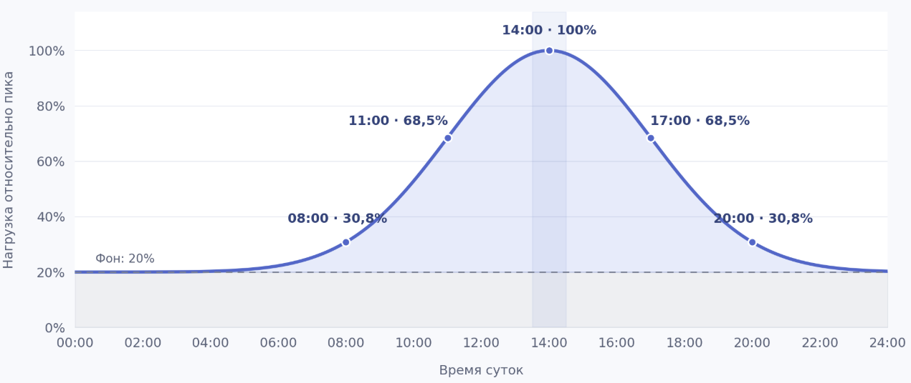

# ПР4

> **Важно: это учебный проект.** В материалах используются общедоступные сведения о Яндексе (Yandex), Yandex Cloud и Monium со ссылками на публичные источники. Оговорка о вымышленности не распространяется на сведения, прямо подтверждённые этими источниками. Все остальные конкретные данные — цены и тарифы, правила, требования, ограничения, показатели, состав команд, архитектура, процессы, SLA/SLO, сроки и компенсации — являются вымышленными условиями учебного сценария. Авторские расчёты, оценки, таблицы и иллюстрации на основе публичных данных также являются учебными и не подтверждают реальные показатели или обязательства компании и сервиса. Материалы не являются официальной документацией или заявлениями Яндекса, Yandex Cloud и Monium. Формулировки «мы», «наш сервис» и подобные относятся к участникам учебного сценария.

## Паспорт

### Компания и продукт

Yandex

Observability платформа Monium

https://monium.yandex.cloud

### Тип цифрового бизнеса

Тип: SaaS

Модель монетизации: Pay-per-use

### Выбранный ИТ-сервис

Сервис квотирования - это наш сервис который отвечает за управления всеми доступными пользователю квотами. Этот сервис хранит эти квоты и предоставляет API другим сервисам, для их изменения + получения текущих лимитов и юзаджа. 

В исходном состоянии QS отвечает за квотирование метрик; в выбранной паре R8→R9 начинается ограниченный пилот квот логов. Границы пилота и документальная область SLA разобраны в документе передачи.

### Годовой оборот и способ подтверждения

Мы тарифицируем пользователей: 
- по использованию метрик (объем хранения шт, величина потока на запись шт\с)
- по записи логов \ трейсов в секунду (объем ГБ)
- по числу вычисляемых алертов и сработавших эскалаций

Для учебного расчёта используются [публичные тарифы Monium](https://yandex.cloud/ru/docs/monium/pricing) и опубликованные показатели нагрузки (см. раздел «Пользователи и нагрузка»). Сам расчёт и его допущения являются авторской учебной моделью.

Для условной оценки выручки опубликованные значения приняты за пиковые. Это допущение учебного расчёта; предполагаемый профиль нагрузки представлен на иллюстрации:

Расчёт по публичным тарифам с принятым учебным профилем нагрузки даёт условную выручку около 15 млрд в год. Это результат авторской модели, а не опубликованная финансовая статистика или подтверждённая реальная выручка Monium.

### Пользователи и нагрузка

По сути сервисом опосредовано пользуются все, как и внешние клиенты, которые записывают в нас телеметрию, так и соседнии с нами сервисы, для того чтобы ограничивать те или иные потоки данных исходящие от клиентов на основе выставленных для них лимитов.

MAU 16.000 пользователей

3.000.000.000 семплов метрик в секунду

44.000.000 миллионов спанов в секунду

60ГБ/c обрабатываем логов

Источник показателей пользователей и нагрузки: [публичная страница команды Monium](https://yandex.ru/jobs/services/cloud/monium). Использование этих показателей как пиковых в расчёте выручки — отдельное учебное допущение.

### Режим данных

Наши данные - это телеметрия, мы занимаемся ее сбором (свои агенты, фетчеры), приемкой (инжест), обработкой (временные рядя, логи, трейсы) и выстраиванием платформы поверх этих данных (считаем алерты, SLO, рисуем дашики, графики, итд итп). Это если говорить про весь продукт в целом.

Конкретно в QS данные телеметрии мы не храним и не обрабатываем, тут данные - это деревья квот, где по каждому проекту, шарду мы храним узлы с потреблением и лимитами квот.

## Передача требований и SLA

Перед каждым релизом Change coordinator заполняет [документ передачи](requirements-and-sla-transfer.md). Команда согласует в нём результат, оставшиеся задачи, доступных людей и условия выпуска. Service owner подтверждает ресурс, а Change authority разрешает выпуск после проверок. Порядок работы описан в [регламенте сервиса](../task2.md#передача-требований-и-sla-между-релизами).

В документах рассмотрены три ситуации:

- [R1 → R2](r1-r2-transfer.md) передаётся после инцидента. Ноябрьский P1 уже восстановлен, но в декабре нужно закончить 84 часа профилактики и проверить устранение причины.
- [R4 → R5](r4-r5-transfer.md) проходит в условиях сжатых сроков. Проверка передачи обязательств заканчивается 17.03, выпуск обещан на 18.03, а 16.03 выясняется, что часть общих смен занята другой миграцией.
- [R8 → R9](r8-r9-transfer.md) начинается как плановая передача. Новый вид квот согласован 28.06, проверки назначены до запуска пилота 15.07. Позднее выясняется, что коммерческое обещание общего пула не совпало с согласованными возможностями.

## Правила передачи

У каждого незавершённого обязательства сохраняются исходный срок, ответственный и следующий шаг. При передаче другой смене принимающий подтверждает, что понимает задачу и имеет время на её выполнение. Service owner согласует участие общих команд до обещания даты клиенту.

Change coordinator сверяет обещания клиенту с техническим контрактом и подтверждениями смежных сервисов. Если меняются объём, режим, дата или исполнители, затронутые участники согласуют изменения повторно. Перед выпуском Deployment manager проверяет, что разрешение относится к нужной версии и все обязательные проверки завершены.

Команда соблюдает [внутренние сроки оценки, ревью, сборки, выкатки и отката](../task2.md#внутренние-сроки-технической-команды). Service level manager проверяет их достижимость по первым трём передачам. Клиентские гарантии при этом остаются прежними.

## Общие проблемы

### 1. Согласованный выпуск принимают за согласованный клиентский результат

В R2 клиент ожидал перераспределение между проектами, хотя автораздача работала внутри одного проекта. В R3 после согласования выпуска появился отдельный участник приёмки. В R9 продажа общего пула снова опередила подтверждение возможностей сервиса. Это повторение одной проблемы: разные участники согласовали разные результаты.

В [Change enablement](../task2.md#change-enablement) уже есть критерии результата, проверка клиентских сценариев и согласование изменений. Не хватает явной сверки обещания с возможностями всех зависимостей, включая случаи, когда сам API не меняется.

**Изменения в регламенте.** Change coordinator и Customer сверяют обещанный результат с возможностями всех зависимостей. При изменении даты, охвата или режима работы затронутые условия согласуют повторно.

### 2. Обязательство может остаться у человека или исчезнуть из следующего плана

В R4 обнаружились обещания из января, которых не было в общей очереди. После нескольких релизов также остаются снятые с плана задачи: массовая выгрузка, большой экспорт, дополнительные отселения и расширение пилота logs. Их перенос сам по себе допустим, но описание очередного релиза не даёт полного ответа о судьбе всех прежних задач.

[Приём обращений](../task2.md#приём-и-учёт-обращений) и [передача между релизами](../task2.md#передача-требований-и-sla-между-релизами) уже требуют регистрации и передачи незавершённой работы. Нужно уточнить, как сверяется полнота и как сохраняется решение об отложенных задачах.

**Изменения в регламенте.** Принятые в переписке обязательства регистрируют с исходной датой. При передаче Change coordinator и Service desk agent сверяют оставшиеся задачи и фиксируют, что выполняется, откладывается или отменяется.

### 3. Месячный ресурс не подтверждает готовность конкретной смены

В R5 оплаченные часы общих команд оказались заняты другим проектом. В R7 люди были на месте, но диагностика зависела от одного эксперта, занятого координацией. В R10 восстановление задержали полномочия, которые на учении выдали заранее. Во всех случаях формальное назначение не означало возможности выполнить работу в нужный момент.

[Роли](../task2.md#роли) и раздел передачи описывают ответственность и проверку ресурса, но не задают обязательную проверку замещения в реальных условиях.

**Изменения в регламенте.** Service owner подтверждает доступность общих смен, а Deployment manager проверяет исполнителя, заместителя и их права. Если основной эксперт нужен для диагностики, роль Incident manager принимает другой подготовленный участник.

### 4. Доказательство готовности не всегда относится к условиям выпуска

В R6 разрешение опиралось на проверки другой версии и малого дерева. В R8 использовали инструкцию общего пула для горячей ноды. В R10 успешное дневное учение с подготовленными разрешениями не подтвердило вечернее восстановление. Это разные проявления одной ошибки: результат проверки перенесли на условия, которые она не покрывала.

В [управлении выкаткой](../task2.md#управление-выкаткой) уже обязательны версия, тесты и допустимый откат. Запрет ложной экстренности тоже есть. Здесь нужно конкретизировать проверку применимости и проверить, что отказ действительно останавливает выпуск.

**Изменения в регламенте.** Deployment manager сверяет применимость тестов и инструкций к выпускаемой версии и условиям работы. Problem manager закрывает профилактику после проверки всех исходных критериев.

### 5. Обязательства зависимостей не сопоставлены со сроком QS

В R3 готовность выгрузки зависела от получателей и согласий владельцев. В R9 дата включения logs не учитывала отсутствие нужной функции инжеста. В R10 круглосуточная регистрация заявки оказалась совместима с началом инженерной работы только утром. Резервная линия зависела от того же разрешения, что и основная.

[Service level management](../task2.md#service-level-management) требует пересмотра условий при изменении зависимостей и учитывает их отказы. При этом нет отдельной проверки, позволяют ли их реальные сроки и полномочия выполнить SLA QS.

**Изменения в регламенте.** Service level manager сопоставляет условия зависимостей со сроками QS. Если они не позволяют выполнить SLA, Service owner обеспечивает проверенный независимый способ восстановления.

### 6. Постоянные проверки накапливаются, но их ресурс легко принять за свободный

После R3 регулярный контроль занимал 4 часа в месяц, после R5 уже 8, после R6 20, после R7 30, после R9 34. В R10 добавлены ещё 10 часов на следующий месяц. Сами релизы эти затраты в основном считают корректно. Риск возникает при следующем планировании, если разовую профилактику закрывают вместе с её постоянным сопровождением или смотрят только на общий резерв команды.

Раздел передачи требует проверки ресурса, но не выделяет накопленное сопровождение. R5 и R8 показывают, почему суммарных свободных часов недостаточно: ограничением становятся конкретные сотрудники и смены.

**Изменения в регламенте.** Service owner учитывает накопленные регулярные проверки по исполнителям до распределения новых задач. Problem manager подтверждает, какие меры продолжаются после закрытия разовой профилактики.

### 7. Профиль нагрузки и эксплуатационные документы отстают от развития сервиса

В R2 общий RPS укладывался в предел, но повторы конкурировали за несколько горячих деревьев. После R6 появился фон догона биллинга, в R8 разделились горячий и общий пулы, в R9 добавились logs, а R10 потребовал переноса нагрузки целой зоны. Исходный тест не подтверждает все эти режимы. В текущем регламенте обязательные прогоны и численные пороги оповещения всё ещё привязаны к исходным 400 000/600 000 Read и 5 000 Write RPS.

[Capacity and performance management](../task2.md#capacity-and-performance-management) уже требует прогноза, теста оставшейся мощности и расширения при 80%. Менять этот порог из-за описанных событий оснований нет. Нужно связать проверки с актуальной архитектурой и поддерживать документы в согласованном состоянии.

**Изменения в регламенте.** При изменении нагрузки или архитектуры ответственные за мощность, выкатку и мониторинг обновляют связанные проверки, инструкции и настройки. Change coordinator проверяет их актуальность при передаче релиза.
